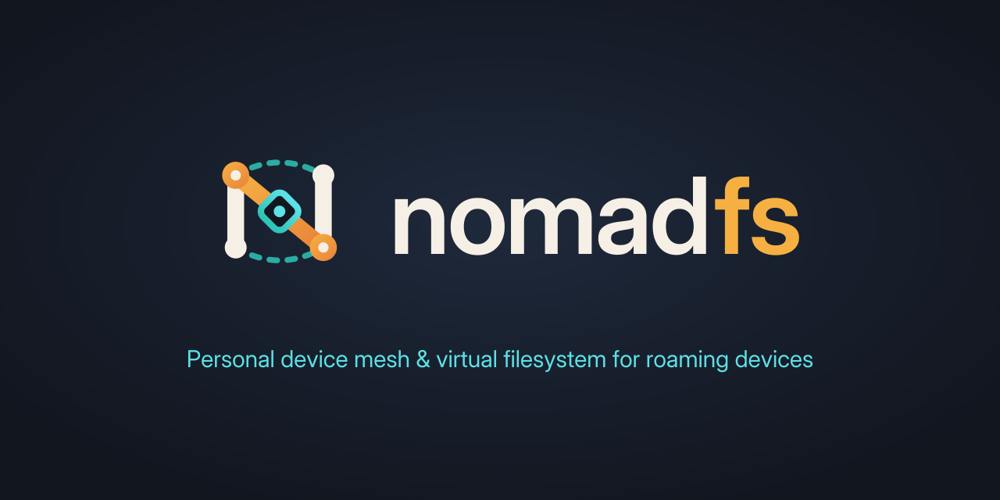

<p align="center">
  <picture>
    <source media="(prefers-color-scheme: dark)" srcset="assets/brand/nomadfs-wordmark-dark.svg">
    
  </picture>
</p>

<h3 align="center"><em>Your files roam with you.</em></h3>

<p align="center">Personal device mesh &amp; virtual filesystem for roaming devices</p>

<p align="center"><sub>Built with <a href="https://ziglang.org/">Zig</a> &amp; <a href="https://oriel.foreachdeveloper.com">Oriel</a> by <a href="https://www.foreachdeveloper.com/">foreachdeveloper</a></sub></p>

<p align="center">
  
</p>

# NomadFS

NomadFS is a private, distributed filesystem and device mesh written in [Zig 0.16](https://ziglang.org/). It connects laptops, desktops, phones, and servers into a secure peer-to-peer storage mesh. Share folders across devices with instant metadata and on-demand streaming, collaborate via a CRDT-replicated swarm folder, and mount your mesh directly into your operating system with FUSE.

All core features are verified on real hardware across Linux desktop and Android (tested on an Android phone and Linux workstation).

**Download:** the [latest release](https://github.com/highercomve/nomadfs/releases/latest) has the app for Android (APK) and Linux (AppImage, deb, rpm), and the `nomadfs` CLI for Linux. Docs: [nomadfs.foreachdeveloper.com](https://nomadfs.foreachdeveloper.com).

---

## Key Features

### Shared Folders (On-Demand Streaming & Filestore)
- **Instant visibility**: Share any local folder (`--share Name:/path` or in config); every paired device sees the complete directory listing immediately.
- **On-demand streaming**: File bytes are never bulk-transferred ahead of time. Range reads fetch only the specific blocks requested by the application reading the file.
- **Zero data duplication (Filestore)**: Shared files are **not** copied into the local block store. Leaf chunks are served directly from the source files on disk.
- **Read integrity**: Leaves are re-hashed against their Content Identifiers (CIDs) on every read. Modified files fail matching rather than serving stale or corrupted data.
- **Background indexing**: Folders are indexed and monitored asynchronously without blocking node operations.

### Swarm Folder (Conflict-Free Collaborative Folder)
- **Shared read/write space**: A global folder where any authorized device in the swarm can create, edit, rename, and delete files.
- **CRDT replication**: Folder manifests are replicated as state-based CRDTs with Lamport logical clocks and version histories, converging deterministically across all nodes.
- **Conflict preservation**: Concurrent edits to the same path are preserved rather than overwritten—the higher version keeps the path while the competing version is renamed to `name (conflict from <device>).ext`.
- **Edit precedence**: Concurrent edits always win over deletes. Deletes propagate as tombstones.
- **Distributed content fetching**: File content remains on the author's device and is pulled on demand by peers, after which any caching peer can serve it.
- **Backup devices**: A desktop or server with `swarm_backup = true` (`--swarm-backup`, or Settings → Swarm backup in the app) keeps a copy of every file, so the folder stays readable while the device that added a file is offline.

### Desktop Mount (Linux FUSE)
- **Direct kernel protocol**: Speaks the FUSE kernel protocol on `/dev/fuse` directly (no `libfuse`), mounting unprivileged through `fusermount3`.
- **Remote shares (`<mount>/<device>/<share>/...`)**: Read-only browsing with on-demand chunk streaming and local block caching for offline resilience.
- **Swarm mount (`<mount>/Swarm`)**: Fully writable folder supporting file creation, writes, `mkdir`, `unlink`, `rmdir`, and `rename`.
- **Editor compatibility**: Supports atomic save routines (write temporary file followed by rename).
- **CLI & daemon**: Run via `nomadfs --mount <dir>`.

### One-Time Invites & Mutual Trust
- **Zero-leak pairing**: Join devices to a swarm without exposing or copy-pasting the master swarm key.
- **Time-limited single-use tokens**: Invites generate a URI (`nomadfs://invite?addr=..&token=..`) with a 128-bit random token expiring after 10 minutes.
- **Noise XXpsk3 security**: Both devices derive a pre-shared key from the token and perform a `Noise_XXpsk3` handshake with ephemeral keys.
- **Ticket exchange**: Devices swap signed pairing tickets inside the encrypted tunnel, mutually registering cryptographic identities and trust before exchanging the swarm key.
- **QR code workflows**: Invites display as terminal and GUI QR codes; the Android app scans them directly with the device camera.

### NomadFS App (`nomadfs-gui`)
Built with [Oriel](https://github.com/highercomve/Oriel) as a lightweight native desktop and mobile application:
- **Platforms**: Linux desktop and Android (smartphones, tablets, and Chromebooks).
- **Remote browsing**: Browse shares across all online devices with responsive tree views.
- **In-app previews**: View images, stream audio and video, view PDFs, and inspect text files without saving them locally first.
- **Downloads**: Download individual files or directory trees directly to local storage.
- **Local shares**: Pick and share host folders using the system folder picker.
- **Mount management**: Dedicated Mount tab and system tray icon to keep the FUSE mount running in the background when the main window is closed.
- **Connect & QR scanner**: Display swarm invites as QR codes and scan incoming invites with the camera.
- **Text Drop**: Share quick notes and text snippets addressed by CID across devices.
- **Device management**: Inspect trusted peers and revoke access with a single click, and rotate the swarm key for every trusted device.
- **Background on Android**: An optional "keep running" mode (a foreground service with a notification) keeps the phone reachable and the swarm folder syncing after you leave the app.

### Core Architecture
- **Content-addressed storage**: Merkle DAG representation using FastCDC content-defined chunking; every block is addressed by its SHA-256 hash.
- **Discovery & routing**: Kademlia DHT for decentralized peer discovery and addressing.
- **Encrypted transport**: Native persistent TCP connections secured with the Noise Protocol Framework (`XXpsk3` / `IK`) and multiplexed with Yamux streams.
- **Identity & trust**: Ed25519 and X25519 pinned identities with local revocable trust stores.
- **Mobile C ABI**: Unified C API (`src/mobile/api.zig`) providing the foundation for Android JNI and Oriel GUI bindings.

---

## CLI Usage

```bash
# Start node and mount shares to a local directory
nomadfs --mount /mnt/nomadfs --share Photos:/home/user/Pictures

# Generate a 10-minute one-time invite with QR code
nomadfs --invite

# Display pairing ticket for manual pairing
nomadfs --pair

# Trust a device pairing ticket
nomadfs --trust "nomadfs://pair?..."

# List trusted devices
nomadfs --devices

# Revoke a device's trust
nomadfs --revoke <device-id-or-fingerprint>
```

---

## Build

### Prerequisites
- [Zig 0.16.0](https://ziglang.org/download/)
- Linux: `fusermount3` (for FUSE mounting)

### Core Library & CLI
```bash
# Build the CLI binary (zig-out/bin/nomadfs)
zig build

# Run unit tests
zig build test
```

### Desktop App (`nomadfs-gui`)
The app uses [Oriel](https://oriel.foreachdeveloper.com) v0.19.6, which `zig build` fetches.

```bash
cd nomadfs-gui

# Build desktop application (zig-out/bin/nomadfs-gui)
zig build

# Run GUI command tests
zig build test
```

### Android App
```bash
cd nomadfs-gui

# Build the Android binary via Oriel
zig build -Dtarget=aarch64-linux-android

# Package APK using Gradle
cd android
./gradlew assembleDebug
```
