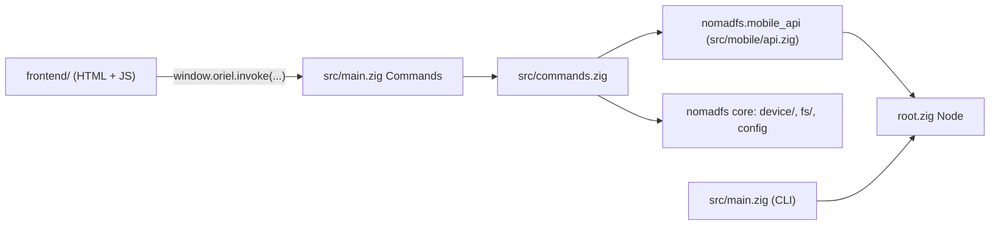

# Chapter 7: The App (`nomadfs-gui/`)

NomadFS ships one app for the Linux desktop and Android phones, built with
[Oriel](https://oriel.foreachdeveloper.com) (`nomadfs-gui/build.zig.zon` pins Oriel **v0.20.7**;
minimum Zig 0.16.0). Oriel pairs a Zig backend with the system web view (WebKitGTK on Linux, the
Android WebView on phones). The page is plain HTML and JavaScript with no build step
(`frontend/index.html`, `frontend/app.js`, `frontend/style.css`).

This chapter stays at a high level: how the app reaches the core, and what each section does.
User-facing walkthroughs are in the [docs](https://nomadfs.foreachdeveloper.com/docs/).

## 1. One core, three front ends

`build.zig.zon` takes the core as a path dependency, `.nomadfs = .{ .path = "../src" }`: the same
sources the CLI and the mobile bindings build from.



- `src/main.zig` declares the `Commands` the page can call (`window.oriel.invoke("name", args)`) and
  the `Events` pushed back (`node_state`). Work that touches the node, the network or the disk runs
  on a worker thread, so a slow command never freezes the window.
- `src/commands.zig` holds one global node handle (`g_node`) behind one mutex. It reuses the C ABI
  layer `nomadfs.mobile_api` (`src/mobile/api.zig`, see [Mobile API](../mobile/api.md)) for the
  node's lifecycle (`nomadfs_node_*`, `nomadfs_put_file`), and calls the Zig core directly for
  everything else: pairing tickets and the trust store (`nomadfs.device`), invites, shares, the
  swarm folder and the mount (`nomadfs.fs`).

Command groups in `commands.zig` (the page calls them in snake_case, e.g. `node_open`):

| Group | Commands |
| :--- | :--- |
| Node | `nodeOpen`, `nodeClose`, `nodeState`, `ensureConfig`, `setNickname`, `aboutInfo` |
| Browse | `remoteDevices`, `browse`, `readRange`, `download` |
| Shared folders | `sharesLocal`, `pickedFolder`, `shareAdd`, `shareRemove` |
| Swarm folder | `swarmList`, `swarmAddFile`, `swarmMkdir`, `swarmDelete`, `swarmRename`, `swarmReadRange`, `swarmDownload`, `swarmSync`, `swarmBackupStatus`, `swarmBackupSet`, `swarmRotateKey` |
| Mount (Linux) | `mountStatus`, `mountPeek`, `mountStart`, `mountStop`, `emergencyUnmount`, `openPath` |
| Connect | `inviteCreate`, `inviteStatus`, `inviteCancel`, `inviteAccept`, `joinInfo`, `pairTicket`, `trustDevice`, `devicesList`, `revokeDevice` |
| Text drop | `putText`, `getText` |

## 2. Sections of the app

The navigation (a drawer on wide windows, a bottom bar on phones) has:

- **Browse**: every reachable device and its shares, walked one dir block at a time
  ([Chapter 5.1](../fs/shares.md)). Paired devices show their local trust-store label and a "Paired"
  badge; unpaired devices show their short fingerprint and a "Not paired" badge, with any claimed
  nickname qualified in secondary text. The viewer previews images, video, audio, PDF and text, reading
  in pieces with `readRange`; **Download** saves to `~/Downloads/NomadFS` (Android:
  `Download/NomadFS`). The viewer's ⋮ menu is the file's row menu (each source's `menu(e)`). A
  video plays in Oriel's native player embedded under the viewer's bar (`oriel.video.play` with
  `rect`, kept in place by `setRect`), with its own fullscreen button; the page hides it with
  `setVisible(false)` while a menu or dialog is over it. On touch screens a sideways swipe in the viewer opens the next or previous
  file. Refresh walks the open path again by name from the device's current share list, since a
  share's root changes with every edit. A file's **ⓘ** opens its details (`file_details`):
  `fs.inspect.inspect` (`src/fs/inspect.zig`) loads the parent blocks only and lists the leaves from
  their links, and `StorageEngine.locate` says where each leaf is here (kept, read cache, a shared
  file through the filestore, or missing). The dialog shows the CID, depth and chunk sizes against
  the FastCDC bounds, a chunk map drawn to scale, and the first eight chunks
  ([DAG](../storage/dag.md), [Disk engine](../storage/engine.md)). A device's **ⓘ** (in the device
  list, and in the header while browsing it) asks it about itself on demand (`device_info`, the
  `GET_NODE_INFO` message, `src/node_info.zig`): version, platform, uptime, the free space of the
  disk its store is on, kept blocks, read cache, quota, connections, shares, swarm folder and
  backups. A device answers only devices it trusts. The app turns the numbers into health checks
  (disk under 10% or 5% free, quota, unreadable shares, no connections, swarm folder not synced for
  10 minutes, swarm backup files nobody could serve, mobile data).
- **Swarm folder**: the shared folder every device writes ([Chapter 5.2](../fs/swarm.md)), with
  add, new folder, rename, delete, the author of each file, and the last sync.
- **Downloads**: what **Download** saved (`nomadfs-gui/src/downloads.zig`). Each copy runs on its
  own thread through `Node.saveFile`, whose `SaveProgress` hook reports bytes written and checks a
  cancel flag; the page follows `download://progress` events. The list lives in `downloads.json`
  beside the config. A finished download previews from its saved file (`download_read_range`, and the
  media server's `l` URLs), opens in another app, or opens its folder: `download_open` and
  `downloads_open_folder` call Oriel's `App.openPath` with the saved path (GIO's default app on the
  desktop; on Android the chooser with a read-only `content://` URI, and Files for the folder).
- **Shared folders**: pick a folder with the system picker (GTK on Linux, the Storage Access
  Framework on Android), name it, share it. Shares are saved in the app's configuration. A new
  share reads "Indexing… N files so far" while its first scan runs; other devices already see what
  it has done ([Chapter 5.1](../fs/shares.md)).
- **Mount** (Linux only): mounts at `~/NomadFS` by default ([Chapter 5.3](../fs/fuse.md)). The
  tray menu has the same switch.
- **Connect devices**: create a one-time invite (code + QR), or join with a code or a QR scan (the
  page's camera through `BarcodeDetector`, so phones scan and desktops show). See
  [Invites](../security/invites.md).
- **Text drop**: store a short note in the swarm and open it on another device with its code (the
  CID returned by `nomadfs_put_file`).
- **Node & trust**: node state and device ID, nickname, trusted devices and revocation
  ([Device identity & pairing](../security/pairing.md)), swarm key rotation (cross-referencing online
  devices by authenticated fingerprint rather than claimed nickname), the "Back up the swarm here"
  switch (desktops), "Keep each swarm file on" (the swarm's signed `copies`, `swarm_replicas_set`)
  and "Accept copies of other devices' files" (`accept_copies_set`, off on phones by default). The
  last two are policy, not distribution: the app signs a setting; the cluster layer decides what
  that means ([Chapter 4.3](../cluster/placement.md)).
- **About** (also the "built with" line at the bottom of the drawer): the NomadFS, Oriel and Zig
  versions and the commit the app was built from, the platform and app size, this device's name,
  fingerprint, node ID, port and addresses, devices connected and trusted, and the configuration
  and data paths with the data's size. **Copy** puts it all on the clipboard for bug reports.
  `build.zig` passes the versions in an `about` options module: NomadFS's from its own
  `version`, Oriel's read from the Oriel package's `build.zig.zon`, the commit from `git` (with
  a `+` when the checkout has local changes).

**Loading.** A list that loads something new (Browse's devices and folders, the swarm folder,
shared folders, trusted devices) clears its old rows at once and shows placeholder rows
(`listLoading`) until the answer arrives; refreshing the same place keeps its rows and only spins
the button. Each navigation is numbered (`browseNav`, `swarmNav`, `sharesNav`), so an answer for a
place the user already left is dropped instead of drawn over the current one.

**Back** (Android's back button and gesture, a mouse's back button) goes up one level: it closes
the open file or the More sheet, then goes to the parent folder, then back to Browse; at the top
the app goes to the background. The WebView follows the page history, so the page keeps one history
entry per level it can go up (`syncBack`), added right after the tap that went deeper: the WebView
skips entries a page adds without a user gesture.

## 3. Configuration the app writes

`ensureConfig` creates `~/.nomadfs/nomadfs.conf` on first run (on Android, the app's private data
directory), CLI-compatible, with:

```ini
[node]
nickname = "<hostname>"        # "gui" on Android until the page renames it to the phone model
swarm_key = "<64 hex>"
key_path = "<data dir>/keys/node.key"

[storage]
enabled = true
storage_path = "<data dir>/data"

[network]
port = 14700
transport = "tcp"
upnp_enabled = false
enable_mdns = false
write_quorum = 0
accept_copies = false   # phones only
```

`write_quorum = 0` keeps `nomadfs_put_file` (Text drop) from failing when no peer is there to
acknowledge a provider record ([Quorum](../cluster/quorum.md)). LAN announcements and UPnP
are off by default: devices find each other through the addresses saved by invites.

When an invite is accepted, `inviteAccept` rewrites the config: it replaces `swarm_key` with the
one received and appends the inviter's `tcp://ip:port` to `bootstrap_peers` (`addBootstrapPeers`),
so the two devices find each other again after a restart. `nodeOpen` dials those peers.

> **Note:** the first-run `swarm_key` is generated with `std.Random.DefaultPrng` seeded from the
> current time (`ensureConfig`), not from the OS's cryptographic random source. Joining a swarm with
> an invite replaces it with the inviter's key.

## 4. Platform specifics

- **Desktop tray** (`src/tray.zig`): the app keeps running, and keeps the mount served, after its
  window closes. Left click shows or hides the window; the menu mounts and unmounts, opens the mount
  folder, and quits (unmounting first).
- **Android background** (`src/background.zig`): a foreground service with an ongoing notification
  and a Stop button keeps the node running while the app isn't in front, so other devices can still
  browse the phone and the swarm folder keeps syncing. The Node & trust section shows whether
  battery optimisation still applies and opens the system settings to turn it off.
- **Android storage** (`android-src/StorageExtension.kt`): "All files access"
  (`MANAGE_EXTERNAL_STORAGE`) so folders such as `DCIM/Camera` can be shared and downloads saved to
  `Download/`. Staging files go to the app's cache directory, since Android has no `/tmp`.
- **Updates** (`src/updates.zig`, Oriel's `oriel.updater`): each GitHub release carries a
  `latest.json` signed with the release key (Ed25519), whose public half is `update_public_key` in
  `build.zig`. The app checks it 15 s after starting and every 6 hours (About has the switch and a
  "Check for updates" button; a dot on About marks a new release). How it updates depends on the
  install (`update_info`):
  - **AppImage** (`install`): downloads the new AppImage, checks its size and SHA-256, swaps it
    in atomically and restarts (`updater_install`, `updater_restart`).
  - **Android** (`download`): Oriel can only check there; the page opens the new APK in the
    browser, which installs it. Android reports its OS as Linux, so its manifest entries are
    `aarch64-android` and `x86_64-android`, apart from the desktop's `x86_64-linux`.
  - **deb, rpm, a build from source** (`manual`): the page links the release; the package manager
    updates it.

## 5. Building

```sh
cd nomadfs-gui
zig build run        # the desktop app
zig build package    # deb, rpm, AppImage in zig-out/package/
oriel android build  # an APK (needs the Oriel CLI and the Android SDK/NDK)
zig build test       # the commands tests
```

`oriel build`, `oriel run` and `oriel package` are thin wrappers around the same `zig build`
steps (see `nomadfs-gui/README.md`).
