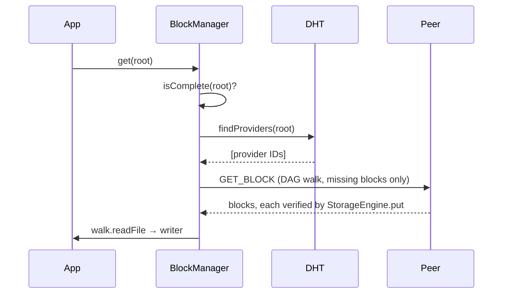

# Chapter 4: Block Exchange & Replication (`src/cluster/`)

The storage stack ([Chapter 3](../storage/overview.md)) keeps blocks on one device. `src/cluster/` moves them between devices. The central type is `BlockManager` (`src/cluster/block_manager.zig`), which ties together the connection manager, the DHT node and the local `StorageEngine`.

> This directory used to be described as `src/dist/` with a consistent-hash ring, quorum reads and writes, vector clocks and Merkle anti-entropy. Most of that was never wired into the running node. This chapter describes what the code does today; the sub-chapters say plainly which files are present but unused.

## 1. What Moves Data in the Running Node

Two different paths move blocks, and the everyday one is not `BlockManager.put/get`:

| Path | Used by | How a source is found |
| :--- | :--- | :--- |
| **Direct reads from a known device** (`src/fs/remote.zig`: `Remote`, `MultiRemote`) | browsing shares, the swarm folder, the FUSE mount | the device is already known: the one sharing the folder, or the author of a swarm entry, then every known peer |
| **`BlockManager.put` / `get`** (provider records + optional replication) | the mobile C ABI (`nomadfs_put_file`, `nomadfs_get_file`) | DHT provider records, then the Kademlia-closest peers |

Both use `BlockManager.connectTo(peer_id)`: look the peer up in the routing table (or run a DHT `lookup`) and open a pooled connection with `connectToPeerMulti`. Both fetch with `GET_BLOCK` and verify every block through `StorageEngine.put` before keeping it.

The first path is covered in [Shared Folders](../fs/shares.md) and [The Swarm Folder](../fs/swarm.md). The rest of this chapter covers `BlockManager`.

## 2. `BlockManager.put(reader)`

```zig
pub fn put(self: *BlockManager, reader: anytype) ![]const u8 // root CID
```

1.  **Store locally.** A `DagBuilder` (`.Balanced`) chunks the stream and writes every block to the local store. Returns `error.StorageDisabled` without a store.
2.  **Announce.** `announce(root)` calls `dht.Node.addProvider(root)`: a lookup for the CID, then `ADD_PROVIDER` to the K = 20 closest peers. Each acknowledgement counts toward the write quorum `W` ([Chapter 4.2](./quorum.md)). With `W = 0` no announcement is made at all. With `W > 0` and too few acks, `put` fails with `error.QuorumNotReached`; the blocks stay stored, and calling `put` again is idempotent and retries the announcement.
3.  **Replicate (optional).** If `replication` (`[storage] replicas`, default **0**, at most 20) is above zero, `replicate(root, replicas)` takes the K closest peers to the CID (`closestFor`) and pushes the whole DAG to each with `RepairManager.push` (one `PUT_BLOCK` per block, verified by the receiver) until `replicas` peers have acknowledged it. This runs **synchronously** inside `put`, and failures are only logged: replication never fails a `put`.

Provider records expire after 24 hours (`providers.default_ttl_s`); nothing re-announces them automatically.

## 3. `BlockManager.get(root, writer, options)`

1.  If `walk.isComplete(store, root)` is false, `fetch(root)`:
    1.  ask the DHT for providers of the CID (`findProviders`: local records plus what the closest peers report, up to 20);
    2.  try each with `RepairManager.sync` ([Chapter 4.1](./repair.md));
    3.  if none succeeds, try the K closest peers to the CID, where `replicate` would have put copies.
2.  Then `walk.readFile` writes the file to `writer`. Because the DAG is complete first, a failure never leaves partial output.

Errors include `NoProvider`, `ProviderUnreachable`, `BlockNotFound` and `StorageDisabled`.



## 4. Consistency

`BlockManager` deals only in immutable, content-addressed DAGs, so there is nothing to reconcile: a CID always means the same bytes. Mutable state lives elsewhere:

*   **Shares** are owned by one device; peers just read its current root CID.
*   **The swarm folder** is a state-based CRDT with **Lamport versions plus an 8-entry history**, and concurrent edits are both kept. See [The Swarm Folder](../fs/swarm.md). It does not use vector clocks.

## 5. Files in `src/cluster/`

| File | Status |
| :--- | :--- |
| `block_manager.zig` | used: `BlockManager` (this chapter) |
| `repair.zig` | used: `RepairManager.sync/syncWhile/push`, the DAG walk ([4.1](./repair.md)) |
| `quorum.zig` | partly used: only `W` and `isWriteSatisfied` ([4.2](./quorum.md)) |
| `ring.zig` | present, effectively unused ([4.3](./ring.md)) |
| `vectors.zig` | present, used only by its tests ([4.4](./vectors.md)) |

## 6. Not Implemented Yet

*   **Background repair or anti-entropy**: no loop compares or re-replicates stored content. The only periodic jobs in the node are the 60 s DHT bucket refresh and revocation sweep (`src/root.zig`) and the 10 s swarm folder sync and backup rounds (`src/fs/swarm.zig`).
*   **Directed sync and backup policies** (for example "phone photos back up only to the home server") are planned in [ROADMAP.md](../../ROADMAP.md). Today the closest thing is a swarm folder *backup device* (`swarm_backup = true`), which copies every swarm folder file.

---

**Next Chapters:**
*   [Chapter 4.1: Fetching DAGs (Repair)](./repair.md)
*   [Chapter 4.2: The Write Quorum](./quorum.md)
*   [Chapter 4.3: The Hash Ring (unused)](./ring.md)
*   [Chapter 4.4: Vector Clocks (unused)](./vectors.md)
