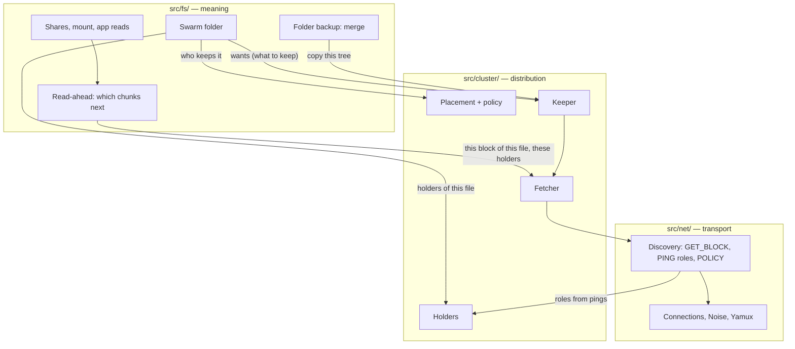

# Chapter 4: The Distribution Layer (`src/cluster/`)

The storage stack ([Chapter 3](../storage/overview.md)) keeps blocks on one device. The
distribution layer decides **where blocks come from** and **which devices keep copies**. It knows
nothing about folders, shares or the swarm manifest: those are meaning, and they live one layer up
in `src/fs/` ([Chapter 5](../fs/overview.md)).

## 1. Three layers, three questions

| Layer | Code | Answers | Never does |
| :--- | :--- | :--- | :--- |
| **Meaning** | `src/fs/` | *What* a device needs: these bytes of this file; this file must be kept here; the author is X. Shares, the swarm manifest, folder trees, the backup merge, read-ahead (which chunks come next). | open a connection to fetch a block, or copy a DAG |
| **Distribution** | `src/cluster/` | *Where from* and *who keeps it*: the holders of a file, the best holder for each block, which devices keep each swarm file, copying a whole file. | know what a share, a folder or a manifest is |
| **Transport** | `src/net/` | *How*: connections, Noise, Yamux, the DHT, relays, the bytes on the wire. | decide what to fetch |

A feature asks the layer below and never works around it. When the distribution layer lacks
something a feature needs, the layer grows; the feature doesn't reach past it. The swarm folder,
shared folders, folder backup, the mount and the app all read and copy through the same code.

Section 6 tells how this was lost and won back ([4.9](./history.md) has the whole story).

## 2. The parts

| Part | File | Job | Chapter |
| :--- | :--- | :--- | :--- |
| `Fetcher` | `fetcher.zig` | Serves each block a read needs from the local store or the best holder; remembers speeds and misses. | [4.1](./fetcher.md) |
| `Holders` | `holders.zig` | Who probably holds what, learned from messages already exchanged. | [4.2](./holders.md) |
| `placement` + `device.policy` | `placement.zig`, `../device/policy.zig` | Who *should* hold each swarm file: the swarm's signed `copies`, rendezvous hashing over members that accept copies. | [4.3](./placement.md) |
| `Keeper` | `keeper.zig` | Makes this device hold what it should: copies whole files through the fetcher. | [4.4](./keeper.md) |
| `BlockManager` | `block_manager.zig` | Owns the fetcher and the holders; dials holders; the mobile C API's `put`/`get`. | below, [4.5](./repair.md) |

## 3. A read, from top to bottom

A video in the swarm folder, played on a laptop:

1. **`fs/`**: the player reads 1 MiB at offset X. `SwarmFolder.readAt` knows the file's root CID
   and its author (from the manifest) and asks for its likely holders: the author, the devices
   placement gives the file, then `Holders.forSwarm` (swarm backup devices, then everyone else).
2. **`fs/`**: `ReadAhead` turns the read into the blocks covering it, and queues the next ones
   (0.5 to 8 MiB ahead, growing while the read continues) for its six workers.
3. **`cluster/`**: each worker, and the reader, calls `Fetcher.fetch(root, cid, holders)`. The
   fetcher picks, per block, the holder with the least expected wait: `(in flight + 1) / measured
   rate`. Six blocks in flight so spread over the holders by speed, with no message the read
   didn't need.
4. **`net/`**: one `GET_BLOCK` on a pooled Yamux stream; the block is checked against its CID,
   kept in the read cache, and handed back.

A shared folder is the same from step 2: its holders are the sharing device, then the devices
known to keep backups of its folders (`Holders.forOrigin`).

## 4. A copy, from top to bottom

A swarm backup device, or a device placement gives a file to:

1. **`fs/`**: the swarm folder, registered as a keeper *provider*, lists the live files this
   device should keep and doesn't yet (every file on a backup device; else the ones placement
   gives it), with their likely holders.
2. **`cluster/`**: the keeper copies each one: the whole DAG through the fetcher, four blocks at
   a time (so a copy spreads across holders too), each kept (pinned) against the quota, file data
   already held skipped without being read.
3. **`fs/`**: the provider hears the outcome and records the file as kept. For a folder backup,
   `fs/backup.zig` then merges the new tree into the kept one, keeping what the phone deleted.

Nothing is pushed when a file is saved: the devices that keep it pull it, after the manifest sync
tells them it exists.

## 5. Lean by design

| Message | Sent when | Cost |
| :--- | :--- | :--- |
| `GET_BLOCK` | only for blocks a read or a copy needs | one per block; a device without the file costs a few misses, then is skipped for that file |
| roles (one byte in PING/PONG) | with pings already sent | 1 byte |
| `POLICY` | to a peer only when it hasn't acknowledged the current settings | ~180 bytes per record per peer, once per change |
| `GET_SWARM` | every 10 s per peer | a 32-byte digest; the manifest only when the contents differ ([5.2](../fs/swarm.md)) |

No announcements, no "who has X?" queries, no periodic per-file traffic. Measured on four devices
(a cloud relay, a home server, a desktop, a phone), a node at rest sends 20 to 50 KB a minute;
before the manifest digest it sent 7 to 17 MB, pulling the whole manifest every 10 s. A read
moves about 1 % more bytes on the wire than the file itself.

## 6. How the layer was lost, and won back

The first design (December 2025) was Dynamo-shaped: a consistent-hash ring placed every block on
N devices, with quorums and anti-entropy. The October 2026 pivot dropped the ring for good reasons
(it would put a third of everyone's blocks on a phone over mobile data). But features were then
built top down, and each chose its sources and made its copies inside `src/fs/`: the shares
browser, the swarm folder, read-ahead, swarm backup, folder backup and push-at-save replicas.
`src/cluster/` became a bypass: no layer knew who held a file, a read used one device at a time,
and three loops copied data three ways.

The fix kept the pivot's goal (directed placement by role and policy, no global ring) and gave the
distribution back its layer. [4.9](./history.md) tells it in detail.

## 7. `BlockManager`

`BlockManager` (`block_manager.zig`) owns the `Fetcher` and the `Holders` and dials holders for
them: `connectKnown` uses a live connection or the routing table's addresses; a holder not met
yet is looked up through the DHT once, and the fetcher backs off if it can't be reached.

It also keeps the mobile C API's own path (`nomadfs_put_file` / `nomadfs_get_file`): `put`
stores a file and announces it as a DHT provider record; `get` copies a whole DAG with the keeper's
copy, the providers and closest peers as holders ([4.5](./repair.md)). Nothing is pushed: there is
no message that writes to another device's store. The app's text drop no longer uses it: notes are
swarm folder files.

---

**Sub-chapters:**
*   [4.1: The Fetcher](./fetcher.md)
*   [4.2: Holders](./holders.md)
*   [4.3: Placement and the Swarm Policy](./placement.md)
*   [4.4: The Keeper](./keeper.md)
*   [4.5: The Mobile API's `put` and `get`](./repair.md)
*   [4.6: The Write Quorum](./quorum.md)
*   [4.7: The Hash Ring (present, unused)](./ring.md)
*   [4.8: Vector Clocks (present, unused)](./vectors.md)
*   [4.9: History: how the layer was lost and restored](./history.md)
