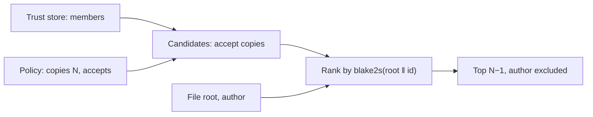

# Chapter 4.3: Placement and the Swarm Policy

Holders ([4.2](./holders.md)) is about who *probably has* a file. Placement is about who *should
keep* it: the answer every device must agree on without asking each other, or two devices could
both decide the other one keeps a file and nobody would.

## 1. The swarm policy (`src/device/policy.zig`)

Two kinds of signed records, spread like membership:

| Record | Subject | Value | Set by |
| :--- | :--- | :--- | :--- |
| `copies` | the swarm | 1 to 8: how many devices keep each swarm folder file | any member (`--copies N`, the app's "Keep each swarm file on") |
| `accepts` | one device | 0 or 1: it keeps copies of other devices' files | that device only (`accept_copies` under `[storage]`; off on phones by default) |

Each record is Ed25519-signed over `nomadfs-policy-v1 ‖ kind ‖ subject ‖ value ‖ at ‖ signer`.

* **Accepted** when the signature verifies, the signer is trusted *when it arrives* (or is this
  device), and it isn't dated more than 10 minutes ahead of this clock. Once accepted it stays,
  even if its signer is later revoked: otherwise devices that heard of the revocation at different
  times would disagree.
* **Newest wins**: the larger `at`, then the larger signer key. An older or equal record is
  acknowledged (`stored = true`) without change, so a sender never resends it in a loop.
* **Kept** in `swarm.policy` next to the trust store; a file that can't be read is moved aside and
  the defaults apply (copies 1, everyone accepts).

### Spreading it (`POLICY`, `src/net/discovery/node.zig`)

After a PONG, and in the membership sweep, a device sends its records to a peer **only when that
peer hasn't acknowledged the current set**: it remembers, per peer, the digest of the records the
peer last took in full. An unchanged policy costs nothing; a change costs one message per record
per peer, once. A receiver that applies a record saves it and wakes the keeper.

## 2. Placement (`src/cluster/placement.zig`)

A swarm file's replica holders are the `copies − 1` members with the highest **rendezvous score**
`blake2s(file root ‖ node ID)`, among:

* this device, when it accepts copies;
* every trusted member with a transport key that accepts copies;
* never the author (it has the file already).

It is a pure function of the trust store, the policy and the file, never of what a device happened
to hear, so every device computes the same holders. Adding a member moves only the files it now
wins (about one in k); removing or revoking one moves only its own.

On top of placement, every **swarm backup device** keeps every file anyway (its `swarm_backup`
setting). So a file lives on its author, the backup devices, and its `copies − 1` placed holders.

## 3. Where it is used

* The swarm folder's keeper provider asks "am I one of this file's holders?" to decide what to keep
  ([4.4](./keeper.md)).
* Swarm reads list the placed holders right after the author, before the cluster's other guesses.

---

**Next:** [Chapter 4.4: The Keeper](./keeper.md)
