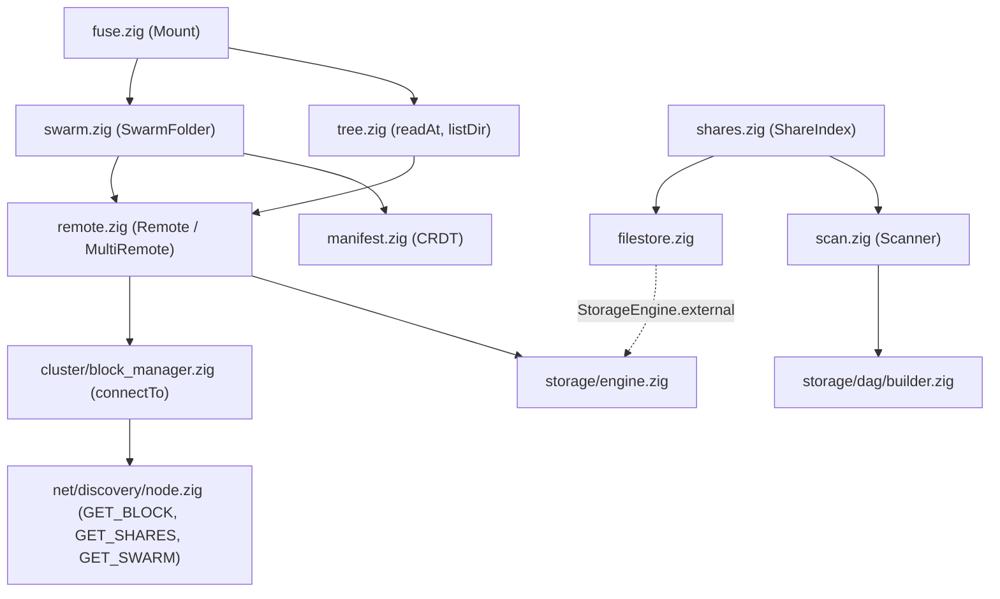

# Chapter 5: Folders (`src/fs/`)

The [storage stack](../storage/overview.md) stores content-addressed blocks and DAGs. The
network stack ([transport](../net/transport/overview.md) and [discovery](../net/discovery/overview.md)) moves
them between devices. `src/fs/` is what a person actually sees: **shared folders**, the **swarm
folder** and, on Linux, a **FUSE mount** that shows both as ordinary directories.

For the concepts with diagrams, see the site's Learn pages:
[Merkle DAG](https://nomadfs.foreachdeveloper.com/learn/merkle-dag/),
[The swarm folder CRDT](https://nomadfs.foreachdeveloper.com/learn/swarm-crdt/) and
[FUSE, no libfuse](https://nomadfs.foreachdeveloper.com/learn/fuse/). This part of the book is the
code-level companion: files, types and functions.

## 1. Module map

| File | Role |
| :--- | :--- |
| `shares.zig` | `ShareIndex`: the folders this device shares, rescanned every 30 s. Answers `GET_SHARES`. |
| `scan.zig` | `Scanner`: turns a local folder into a Merkle tree (file DAGs + dir blocks). |
| `filestore.zig` | `Filestore`: serves shared files' leaf blocks from the files themselves. |
| `tree.zig` | `Loader`, `listDir`, `resolve`, `readAt`: reads a tree one block at a time. |
| `remote.zig` | `Remote`, `MultiRemote`: Loaders that fetch missing blocks from peers and cache them. |
| `manifest.zig` | `Manifest`: the swarm folder's listing, a state-based CRDT. |
| `swarm.zig` | `SwarmFolder`: edits, the 10 s sync loop, reads, and the backup role. |
| `fuse.zig` | `Mount`: the Linux FUSE driver, speaking the kernel protocol on `/dev/fuse`. |

## 2. Where it sits

- Everything below `fs/` is content-addressed: a share or a swarm file is named by a root CID
  ([DAGs](../storage/dag.md)).
- `Remote` reaches a device through `BlockManager.connectTo`, which looks the peer up in the
  routing table or runs a DHT lookup ([lookup](../net/discovery/lookup.md)), then sends
  `GET_BLOCK` ([RPC](../net/discovery/rpc.md)).
- Every block fetched is verified against its CID by `StorageEngine.put` before it is kept, so the
  local store doubles as the cache.

## 3. Wiring in `src/root.zig`

`Node.init` builds the folder layer only when storage is enabled (`[storage] enabled = true`):

1. **Shares.** `fs.ShareIndex.create(...)` installs the filestore as `store.external`, and
   `discovery_node.share_source = index.source()` makes it answer `GET_SHARES`. Each configured
   `share = "Name:/path"` is `register`ed (listed after its first background scan), and
   `index.start()` launches the rescan thread.
2. **Swarm folder.** The manifest lives at `<storage_path>.swarm.json`.
   `fs.SwarmFolder.create(allocator, io, store, connection_manager.node_id, cfg.node.nickname, manifest_path)`
   loads it; `discovery_node.swarm_source = folder.source()` answers `GET_SWARM`;
   `folder.start(block_manager)` starts the sync thread; and `swarm_backup = true` calls
   `folder.setBackup(true)`.
3. **Mount.** The mount is not part of `Node`: `nomadfs --mount <dir>` (`src/main.zig`) and the
   desktop app's **Mount** tab create an `fs.fuse.Mount` over the running node's block manager,
   store and swarm folder.

## 4. Chapters

- [Chapter 5.1: Shared folders and the filestore](./shares.md)
- [Chapter 5.2: The swarm folder](./swarm.md)
- [Chapter 5.3: The FUSE mount](./fuse.md)

User-facing documentation: [Shared folders & mount](https://nomadfs.foreachdeveloper.com/docs/shared-folders/)
and [Swarm folder](https://nomadfs.foreachdeveloper.com/docs/swarm-folder/).
