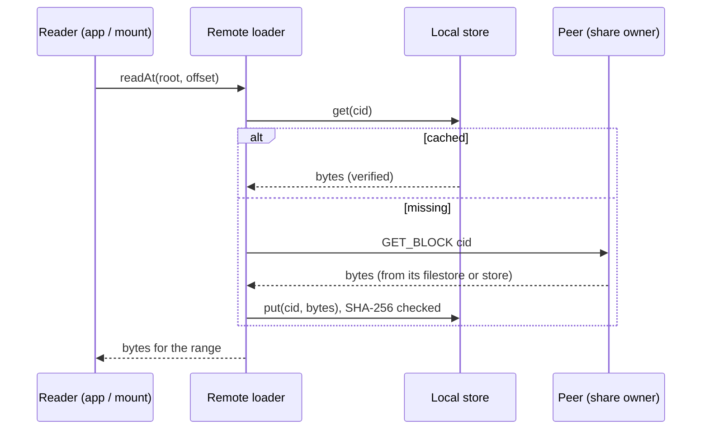

# Chapter 5.1: Shared Folders and the Filestore

A **share** is a folder on one device, published under a name. The device keeps its files where
they are; the rest of the swarm sees the share's listing and fetches file contents on request, one
block at a time. Concepts: [Merkle DAG](https://nomadfs.foreachdeveloper.com/learn/merkle-dag/).
Usage: [Shared folders & mount](https://nomadfs.foreachdeveloper.com/docs/shared-folders/).

## 1. `ShareIndex` (`src/fs/shares.zig`)

```zig
pub const Share = struct {
    name: []const u8,
    path: []const u8,
    root: ?codec.Cid = null, // null until the first scan has something to list
    indexing: bool = false,   // the first scan is still running: `root` is partial
    size: u64 = 0,
    files: u64 = 0,
    scanned_at: u64 = 0,
};
```

- `add(name, path)` registers and scans at once (the app's **Share** button);
  `register(name, path)` only records the share, which the rescan thread scans right away (start-up
  uses this so a large folder never delays the node).
- `remove(name)` drops a share and its filestore table.
- A background thread (`start`/`stop`) calls `rescanAll` every `rescan_interval_ns` = **30 s**.
- `listing()` encodes the current shares as a **dir block** (tag `0x02`, see
  [DAGs](../storage/dag.md)): one entry per scanned share, `kind = .dir`, `cid` = the share's
  root, `size` = total bytes, `mtime` = `scanned_at`. Shares are scanned one at a time; one whose
  first scan hasn't started is listed as an empty dir with `mtime` 0 (as "Indexing…" in the app),
  and from its first progress report on with what it has (below).

### The first scan lists as it goes

A large folder (a media disk) takes hours to hash the first time. Rather than hide it until then,
the first scan of a share reports progress (`scan.Progress`): after `progress_first_ns` = **1 s**
and then every `progress_interval_ns` = **10 s**, the scanner builds a root from what it has done so
far (the directories still being scanned, each holding what it has, stored as dir blocks) and the
share lists that root with `indexing = true`. Other devices see the share fill in.

A folder's whole listing is read before any of it is scanned, its own files are hashed before its
subfolders, and a report lists the subfolders not reached yet as **empty dirs with mtime 0** (real
folders carry their modification time). So every top-level folder of a large disk shows up at once,
and the app shows the unreached ones as "Indexing…".

Every partial root has to be readable, so each report also hands the files scanned since the last
one to the filestore as a **segment** of their own (`Filestore.append`) and the scanner starts a new
table. The scanner never writes to a table a reader can see. Later rescans build one whole table and
`replace` all the segments.

### `GET_SHARES`

`Node.handleGetShares` (`src/net/discovery/node.zig`) replies with `SHARES { nickname, listing }`:
the device's nickname and that dir block (an empty dir block when nothing is shared). Because the
listing is an ordinary dir block, the receiver decodes and validates it with the same code as any
directory (`tree.decodeListing`).

## 2. Scanning (`src/fs/scan.zig`)

`Scanner.scan(path)` returns `Result { root, size, files }`:

- Every **regular file** becomes a file DAG built by `DagBuilder` with the FastCDC chunker
  ([blocks and chunking](../storage/block.md)).
- Every **directory** becomes a dir block (`codec.encodeDir`) listing its children by name.
- **Skipped, not fatal:** symlinks (directories are opened with `follow_symlinks = false`), devices,
  sockets and other special files; names that fail `codec.isValidName` (empty, `.`/`..`, containing
  `/`, `\` or NUL, longer than 255 bytes); entries that can't be read (logged as
  `share: skipping …`); and subtrees deeper than `max_depth` = **32**.
- **Reuse:** the scanner remembers each file's size, mtime (ns), CID and leaf locations. A file whose
  size and mtime match the previous scan is not read again. Files no longer found under a share
  are forgotten at the end of its scan.
- **One set of buffers:** the chunker's buffer and the leaf buffer (`DagBuilder.Scratch`, 1 MiB
  each) are allocated once per `Scanner` and reused for every file. Allocating them per file made
  small files cost about 1 ms each (15 ms on a Rockchip RK3399), 70 times the hashing itself.

### The scan cache (`src/fs/scan_cache.zig`)

What the scanner remembers is also kept on disk, in `scan-cache` in the store directory, so a
restart doesn't re-read every shared file. It is an append-only log after a header:

```
put:  [u8 1][u16 path_len][path][u64 size][i64 mtime_ns][cid: 32]
drop: [u8 2][u16 path_len][path]
```

The last record for a path wins; a torn record at the end (a crash mid-write) is ignored and
overwritten; the file is rewritten without stale records once they outnumber the live ones. New
records are written at every progress report and at the end of each scan.

Leaves are not recorded: a file's parent blocks are already in the store and list them. When a
cached file is needed, `Scanner.leavesFromStore` walks them with `StorageEngine.getLocal` (the
store's own block files only, never a shared file). A balanced DAG keeps every leaf at one depth,
so the first child of a parent tells whether its links are leaves (not stored) or more parents. A
file with one leaf has no parent: its root is that leaf.

An unchanged rescan reproduces the same root CID; any change below the folder changes it.

## 3. The filestore (`src/fs/filestore.zig`)

Copying every shared file into the block store would double the disk space used. Instead the scan
runs `DagBuilder` with a **`leaf_sink`**: leaves are hashed but not stored, and the sink records
where each leaf's bytes sit.

```zig
pub const Leaf = struct { cid: Cid, offset: u64, len: u32 };
// Table: file index -> absolute path, and CID -> { file, offset, len }
```

Only parent and dir blocks are written to the store. After a scan, the share's `Table` replaces the
old one in the `Filestore` (`replace`), so readers never see a half-built table.

The filestore plugs into the engine through `StorageEngine.External { getFn, hasFn }`
(`src/storage/engine.zig`): when `get` finds no block file for a CID it asks the filestore, which
reads the bytes from the original file **and re-hashes them**. If the file changed since the scan,
the hash no longer matches and the block reads as missing, never as wrong data; the next rescan
records the new content. Identical chunks in several files map to one entry ("any copy serves").

Peers fetch shared files with the same `GET_BLOCK` as anything else; they can't tell a filestore
block from a stored one.

## 4. Reading a tree (`src/fs/tree.zig`)

```zig
pub const Loader = struct {
    ctx: *anyopaque,
    loadFn: *const fn (ctx: *anyopaque, cid: *const Cid, allocator: std.mem.Allocator) anyerror![]u8,
};
```

A `Loader` returns verified bytes for a CID. `Loader.local(store)` reads the local store only.

- `listDir(allocator, loader, cid)`: loads one dir block, returns a sorted `Listing`
  (`find` is a binary search).
- `resolve(allocator, loader, root, "a/b/c")`: walks a path, one dir block per component.
- `readAt(allocator, loader, root, offset, dest)`: copies a byte range. For each leaf it descends
  from the root, skipping parent links by their subtree `size` until the link that contains the
  offset (`readLeafAt`, at most 64 levels). Only the blocks covering the range are loaded.

## 5. Remote loaders (`src/fs/remote.zig`)

- **`Remote { block_manager, store, peer }`**: `load` returns the block from the local store if
  present; otherwise it connects to `peer` (`BlockManager.connectTo`), calls `dht_node.fetchBlock`,
  and `store.put`s the result, which rejects bytes that don't hash to the CID. The store is the
  cache: a file read once reads offline afterwards.
- **`Remote.shares()`**: sends `GET_SHARES`, returns the nickname and decoded listing.
- **`MultiRemote { peers }`**: tries the local store, then each peer in order until one serves the
  block. The swarm folder uses it ([Chapter 5.2](./swarm.md)).
- **`knownPeers(block_manager, allocator)`**: every node ID in the routing table. This is the
  "devices I know" list used by the mount, the swarm sync and the backup.



> **Not implemented yet:** cached blocks are never evicted (no LRU cache limit), and there are no
> directed sync or backup policies for shares (for example "back up phone photos only to the home
> server"). Both are planned in [ROADMAP.md](../../ROADMAP.md) (Phase 4).
