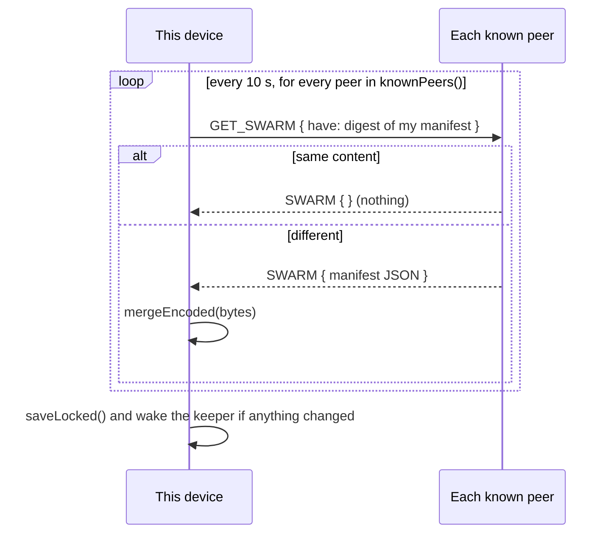

# Chapter 5.2: The Swarm Folder

The swarm folder is one folder that belongs to the whole swarm: any device can add, rename and
delete files in it, with no server. Its listing is a **state-based CRDT** (`src/fs/manifest.zig`);
the folder itself, with sync and backup, is `SwarmFolder` (`src/fs/swarm.zig`).

Concepts, with a diagram: [The swarm folder CRDT](https://nomadfs.foreachdeveloper.com/learn/swarm-crdt/).
Usage: [Swarm folder](https://nomadfs.foreachdeveloper.com/docs/swarm-folder/).

## 1. The manifest (`src/fs/manifest.zig`)

The manifest maps a path to an `Entry`. Every device holds a full copy and merges what its peers
send.

```zig
pub const Version = struct {
    clock: u64,        // Lamport clock
    device: DeviceId,  // [32]u8: the author's transport node ID
};

pub const Entry = struct {
    path: []u8,                                   // "a/b/c.txt", no leading slash
    kind: Kind,                                   // .file or .dir
    cid: Cid, size: u64, mtime: u64,              // files: the content's root CID
    version: Version,
    history: [history_len]?Version,               // the last 8 versions it replaced
    deleted: bool = false,                        // tombstone
    author: []u8,                                 // nickname, display only
};
```

The `device` in a version is the **transport node ID** (BLAKE2s-256 of the X25519 key), because
that is the ID a reader dials to fetch what the author added (`SwarmFolder.self_id`).

### Lamport clock and local edits

`Manifest.clock` is kept above every version seen (`observe` on each merge). `edit(path, change,
device, author)`:

1. validates the path (`validPath`),
2. sets `clock += 1` and stamps `Version { clock, device }`,
3. builds the history: the replaced version first, then its own history, truncated to 8,
4. replaces the entry. Deletes are edits with `deleted = true`.

### Merge rules (`merge`)

For an incoming entry at a path that also exists locally:

| Case | Result |
| :--- | :--- |
| Same version | no change |
| Incoming lists the local version in its history (`descendsFrom`) | incoming wins |
| Local lists the incoming version | local stays |
| Concurrent, one side deleted | **the edit wins** (a delete never beats a concurrent edit) |
| Concurrent, both deleted | the higher version (`Version.greater`: clock, then device bytes) |
| Concurrent, both edits | **keep both**: the higher version keeps the path; the other moves to `conflictPath` with its history cleared |

`conflictPath(path, author)` gives `dir/stem (conflict from <author>).ext` (`/`, `\` and NUL in the
author become `_`; an empty author becomes "another device"; if the result isn't a valid path it
falls back to `dir/conflict.ext`). Every device computes the same name from the same two entries, so
the swarm agrees on the result without coordination.

**Tombstones are never pruned**: a deleted entry stays in the manifest for good.

### Bounds on what a peer may send

`max_path_len` 1024, `max_depth` 32 path components, `max_entries` 100,000 per manifest (a larger
one is refused), `max_author_len` 64 (longer authors are cut). Each path component must pass
`codec.isValidName`. Invalid entries are skipped, not fatal.

### Wire and disk format (JSON)

`encode` writes, and `mergeEncoded` reads, a JSON array of compact entries:

```json
[{"p":"notes.md","k":0,"h":"<cid hex>","s":1234,"m":1761500000,
  "v":{"c":4,"d":"<device hex>"},"o":[{"c":3,"d":"<device hex>"}],"x":false,"a":"Laptop"}]
```

`p` path, `k` kind (0 file, 1 dir), `h` root CID (files that aren't deleted), `s` size, `m` mtime,
`v` version, `o` history, `x` deleted, `a` author. The same bytes are the `GET_SWARM` reply and the
file `<storage_path>.swarm.json`, which is written to `<file>.tmp` and renamed into place
(`saveLocked`). Loading a saved manifest is just a merge into an empty one (files over 64 MiB are
refused).

## 2. `SwarmFolder` (`src/fs/swarm.zig`)

| Function | What it does |
| :--- | :--- |
| `addFile(dir, name, local_path)` | Chunks the file with `DagBuilder` (Balanced layout) **into this device's block store**, then records one edit with the root CID. Unlike shares, swarm files are copied: they belong to the swarm, not to a folder. |
| `makeDir(dir, name)` | A `.dir` entry. Folders are also implied by deeper paths (`Manifest.list`). |
| `remove(path)` | Tombstones the path and every live entry under it. |
| `rename(path, new_name)` / `move(path, new_path, .{ .replace })` | For each live entry under `path`: a new entry at the destination with the same CID, then a tombstone at the old path. With `replace`, whatever was at the target is tombstoned first (POSIX rename). A folder can't move inside itself. |
| `readAt(cid, author, offset, dest)` | Names the file's likely holders (the author, the devices placement gives it, then the cluster's list: swarm backup devices, everyone else) and reads through `ReadAhead`; the fetcher picks a holder per block ([Chapter 4.1](../cluster/fetcher.md)). Any copy of a block will do, since every block is verified. |
| `fileInfo`, `isEmptyDir`, `stagingDir` | Helpers for the FUSE driver ([Chapter 5.3](./fuse.md)). |

### Reading from multiple holders

When reading a file that exists on both the original author (for example, a Phone) and on a backup
or replica device (such as a Home Server), `holdersOf()` supplies all candidate holders to
`ReadAhead`.

With 6 parallel read-ahead workers issuing requests across Yamux multiplexed connections, blocks are
pulled concurrently from both devices. The faster node (e.g. the Home Server on Gigabit LAN)
answers more requests, while the slower node (e.g. the Phone on Wi-Fi) continues to serve chunks in
parallel. Readers never wait on a single bottleneck link.

## 3. Sync: pull every 10 seconds

`start(block_manager)` launches `loop`, which runs `syncNow` every `sync_interval_ns` = **10 s**
(the first round about 2 s after start):



Sync only pulls; each device fetches what it lacks. Because the merge is order-independent, changes
spread through any chain of devices that meet. `status()` reports the entry count, how many peers
answered in the last round, and when it ran.

**Only when it differs.** `Manifest.digest()` is the XOR of a BLAKE2s hash per entry (path, kind,
CID, size, mtime, version and history, deleted, author), so it doesn't depend on the order entries
were learned in: two devices that converged have the same digest, and a peer with the same content
answers with nothing. Before this, every device pulled the whole manifest (850 KB of JSON for 3,369
files) from every peer every 10 s: 7 to 17 MB a minute on an idle swarm. Now a quiet swarm costs a
32-byte digest per peer per round.

## 4. Who keeps copies: backup devices and `copies`

If only the author has a file's blocks, the file can't be read while the author is offline. Two
settings put copies elsewhere; the swarm folder decides *which files* this device keeps, and the
cluster layer's keeper does the copying ([Chapter 4.4](../cluster/keeper.md)):

- **A swarm backup device** keeps every live file: `swarm_backup = true` under `[storage]`, or the
  app's "Back up the swarm here" switch (`setBackup(on)`, which wakes the keeper).
- **The swarm's `copies`** (1 to 8, signed and shared by every device, `--copies N` or the app's
  "Keep each swarm file on") keeps each file on `copies − 1` more devices, chosen per file by
  placement among those that accept copies ([Chapter 4.3](../cluster/placement.md)). A phone
  refuses by default (`accept_copies = false`).

The swarm folder is a keeper **provider** (`keeperProvider`): its `wants` lists the live files this
device should keep and doesn't yet, with the author and the other holders as hints; its `kept`
records each copied root in `<storage_path>.swarm.json.backup`, saved every 32 files or 10 s, so a
restart doesn't check everything again. `backupRound()` runs the same logic once without the
keeper's thread (tests, "sync now"). `backupStatus()` reports files, files kept, bytes, files no
reachable device could serve, and the time of the last round.

Nothing is pushed when a file is added: the devices that keep it pull it once the manifest sync tells
them about it (a sync with changes wakes their keeper). Readers need no setting: the holders list
already includes the backup devices and the placed holders.

> **Not implemented yet:** blocks of deleted or replaced files are never reclaimed, on the author or
> on a copy holder (no garbage collection), and copies made before `copies` was lowered stay. A
> holder that is only offline is not replaced; placement moves files only when membership or
> `copies` changes.
