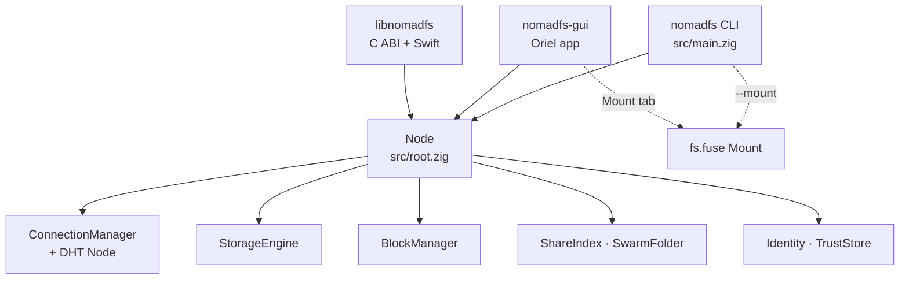

# Architecture: The Node, the CLI, the App and the Library

Every way of running NomadFS, whether the command line, the desktop app, the
Android app or the C library, runs the same core: the `Node` in
`src/node.zig`. This chapter shows what a `Node` contains, how it starts,
and who drives it.

## 1. The `Node`

`Node.init(allocator, cfg)` builds every part from a parsed `nomadfs.conf`
(`src/config.zig`) in this order:

1.  **Network**: `ConnectionManager` (`src/net/transport/manager.zig`) loads
    or creates the X25519 transport key (`node.key`). The node ID is
    BLAKE2s-256 of its public key. Then it starts the connection reaper.
2.  **Storage**: `StorageEngine` (`src/storage/engine.zig`), only when
    `storage.enabled`. It is the block store under `storage_path`.
3.  **Discovery**: the DHT `Node` (`src/net/discovery/node.zig`), which
    answers every RPC. It is given the block store, the nickname and the
    swarm-key epoch.
4.  **Shares**: `fs.ShareIndex` registers each `share = "Name:/path"` and
    starts the rescan thread (only with storage).
5.  **Handlers**: the manager hands every new connection to the DHT serve
    loop, and every LAN-announced peer to `onDiscovery`.
6.  **Distribution**: `cluster.BlockManager`, which owns the fetcher and the
    holder registry ([Chapter 4](../cluster/overview.md)), and the mobile API's
    `write_quorum`.
7.  **Swarm folder**: `fs.SwarmFolder` with its manifest at
    `<storage_path>.swarm.json`. It starts the 10-second sync thread
    (only with storage).
8.  **Hash ring**: `cluster.ring` gets the local node with 10 tokens. Nothing
    reads it ([Chapter 4.7](../cluster/ring.md)).
9.  **Devices**: the Ed25519 identity (`device.key`) and the signed trust
    store (`trust.store`) are loaded. The manager gets a device
    `Authenticator` so every handshake verifies the peer's identity, and
    refuses unknown devices if `require_trusted_devices = true`.
10. **Policy and keeper**: the swarm's signed settings (`swarm.policy` next
    to the trust store; this device's `accept_copies` and `--copies` are
    signed into it) and the keeper, with the swarm folder registered as a
    provider of what to keep ([Chapter 4.4](../cluster/keeper.md)). The
    keeper's thread starts with the listener.

### Lifecycle

*   `init(allocator, cfg)`: builds the parts above.
*   `run(running, cfg)`: listens on `port` (TCP accept loop, LAN
    announcements, UPnP mapping), then blocks until `running` turns false.
*   `bootstrap(peer_urls, swarm_key)`: in a background thread, dials each
    `bootstrap_peers` entry (up to 5 attempts), sends `PING` and `DIAL_BACK`,
    looks up its own ID, then refreshes buckets and sweeps revocations every
    60 seconds.
*   `rotateSwarmKey(allocator, new_key, epoch)`: sends a new swarm key to
    every reachable trusted device.
*   `deinit()`: stops the threads and frees everything.

### Threads

A running node uses threads, not an event loop: the TCP accept loop, one
handshake thread per incoming connection, one Yamux reader per connection,
one handler thread per incoming stream, plus the reaper, the LAN announcer,
the UPnP worker, the share rescanner, the swarm sync loop, the keeper, the
folder backup round, the read-ahead's six workers, and the
bootstrap/maintenance loop.

## 2. Nodes With and Without Storage

`storage.enabled` (default `true`) decides whether a node has a block store:

| | Storage enabled | Storage disabled |
| :--- | :--- | :--- |
| Block store | yes | no |
| Shares, swarm folder | yes | no (`shares` and `swarm` are `null`) |
| `BlockManager.put`/`get` | work | fail with `error.StorageDisabled` |
| Answers `GET_BLOCK` | with its blocks | with no data |
| Takes part in the DHT | yes | yes: the serve loop is always registered |

There is no client-only mode that reads the swarm without storing anything.
Reading needs a block store, which doubles as the cache. Both the CLI and the
app run with storage enabled.

## 3. Who Drives the Node

### The command line (`src/main.zig`)

`nomadfs` reads `nomadfs.conf` from the current folder, `~/.nomadfs/` or
`/etc/nomadfs/` (or `--config <path>`), starts a node and bootstraps.
Flags select extra work: `--share Name:/path`, `--mount <dir>` (Linux FUSE),
`--invite`, `--pair`, `--trust <uri>`, `--devices`, `--revoke <id>`,
`--swarm-backup`, `--address <ip>`. See [Chapter 8.1](../ops/deployment.md).

### The app (`nomadfs-gui/`)

A GUI for the Linux desktop and Android built with
[Oriel](https://oriel.foreachdeveloper.com). It imports the core as a Zig
module and calls it in-process: browse devices, share folders, manage the
swarm folder, create and join invites, mount, rotate keys. See
[Chapter 7](../app/gui.md).

### The C library (`src/mobile/`)

`zig build` also produces `libnomadfs`, a C ABI over the node
(`src/mobile/nomadfs.h`), with Swift bindings in `src/mobile/`
(`Package.swift`). It covers starting a node and storing and fetching files
through `BlockManager`. Pairing, invites, shares and the swarm folder are not
exported; the Android app gets them by linking the Zig module directly. See
[Chapter 10](../mobile/api.md).

