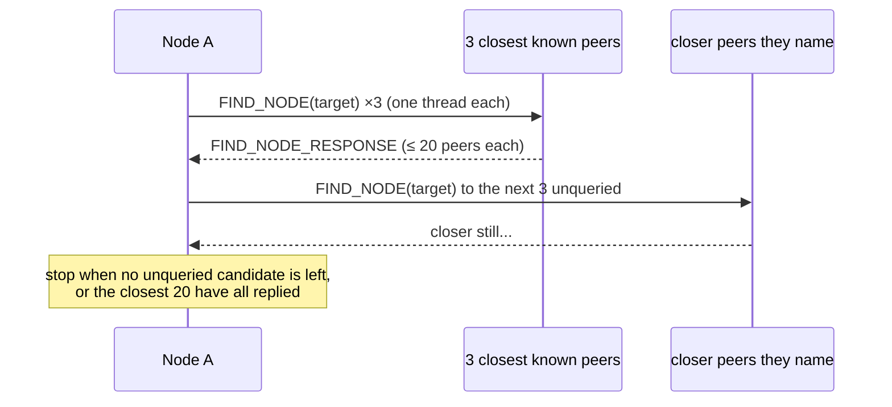

# Chapter 2.3: Iterative Search

Iterative search ("lookup") is how a Kademlia node finds the peers closest to
an ID. NomadFS uses it to find a device whose node ID isn't in its routing
table, to fill its own buckets, and to find values and provider records.

## 1. The Strategy: Convergence

1.  **Start local**: take the K = 20 peers closest to the target from the
    routing table (`getClosestPeers`).
2.  **Query in parallel**: send `FIND_NODE` to up to **α = 3** of the closest
    peers not yet queried (`lookup.Alpha`).
3.  **Refine**: each reply lists the peers *it* knows closest to the target;
    add them to the candidate list.
4.  **Repeat** until the candidates are exhausted or the closest K have all
    replied.



## 2. Managing Search State (`src/net/discovery/lookup.zig`)

```zig
pub const LookupState = struct {
    target: id.NodeID,
    best_peers: std.ArrayListUnmanaged(LookupPeer), // sorted by XOR distance, ≤ K kept
    queried: std.AutoHashMapUnmanaged(id.NodeID, void),
    in_flight: std.AutoHashMapUnmanaged(id.NodeID, void),
    failed: std.AutoHashMapUnmanaged(id.NodeID, void),
    mutex: sync.Mutex = {},
};
```

*   `addPeer(info)`: ignores IDs already queried, failed, or listed; appends
    and re-sorts.
*   `nextPeersToQuery()`: up to `Alpha` peers that are neither queried nor in
    flight. The caller marks them with `markInFlight`.
*   `reportReply(sender, closer)`: marks the sender queried and replied, adds
    the closer peers, and trims `best_peers` to K.
*   `reportFailure(sender)`: moves the sender to `failed` and removes it from
    `best_peers`. A failed peer is never added back in this lookup, even if
    another peer names it.

```zig
pub fn isFinished(self: *LookupState) bool {
    if (self.in_flight.count() > 0) return false;
    var queried_count: usize = 0;
    var unqueried_found = false;
    for (self.best_peers.items) |p| {
        if (p.replied) {
            queried_count += 1;
        } else if (!p.queried) {
            unqueried_found = true;
        }
        if (queried_count >= kbucket.K) return true; // closest K all replied
    }
    return !unqueried_found; // nothing left to ask
}
```

## 3. The Driver (`discovery.Node.lookup`)

`Node.lookup(target)` loops while `!isFinished()`:

1.  `nextPeersToQuery()`. If it's empty but queries are in flight, sleep
    10 ms and retry; if nothing is in flight, stop.
2.  `runLookupRound` starts one thread per peer (at most 3), running
    `lookupNodeWorker`, and **joins them all** before the next round. Our own
    ID is never queried.
3.  `lookupNodeWorker` calls `sendFindNode(addresses, target, peer_id, &via)`.
    It dials with the expected node ID, so a different key at that address
    fails the call. `via` is set to the address the connection really used (it
    stays empty when a pooled connection was reused).

`lookup` returns nothing. Its effect is on the routing table: every peer that
replied is added with **only the address it was reached on**.

### Hearsay is not trusted
Peers listed in a `FIND_NODE_RESPONSE` go into the lookup's candidate list
only, **together with the addresses the replier gave for them**. Those
addresses are never copied into the routing table: a peer enters the table when
*it* replies over an authenticated connection, and then with the address that
connection came from. A peer can't fill our table with made-up entries or
made-up addresses. A failed attempt to reach a candidate by hearsay addresses
alone does not remove anything already in the table.

## 4. Handling Failures and Churn

1.  **Detection**: a dial error, handshake failure, `PeerIdMismatch`, or the
    10-second RPC timeout fails the query.
2.  **Isolation**: `reportFailure` puts the peer in `failed` for the rest of
    the lookup.
3.  **Table cleanup**: the worker calls `routing_table.markDisconnected(id)`,
    which also promotes a replacement ([Chapter 2.2](./kbucket.md)), when the
    peer's own known addresses were tried and failed.
4.  **Continuity**: the next round picks the next best candidates.

`tests/dht/churn_test.zig` checks this on **5** nodes on loopback: the node
closest to a target is stopped, and a lookup must still find the next closest.

## 5. Value Lookup (`lookupValue`)

`lookupValue(key)` first checks the node's own `STORE`d values, then runs the
same rounds with `FIND_VALUE` (`lookupValueWorker`). A reply is either:

*   **closer peers**: handled as above, or
*   **the value**: kept, and returned at the start of the next round. The
    lookup stops there, possibly before reaching the closest nodes.

## 6. Where Lookups Are Used

| Caller | Purpose |
| :--- | :--- |
| `runBootstrap` (`src/node.zig`) | one self-lookup after the bootstrap peers, to fill the buckets near our ID |
| `refreshBuckets` | a random ID in each bucket idle for an hour |
| `BlockManager.findPeer` (`src/cluster/block_manager.zig`) | the node ID of a device to reach (a share's owner, a swarm file's author) when it isn't in the table |
| `addProvider`, `findProviders`, `closestFor` | run `lookup(key)` on a CID first, then send `ADD_PROVIDER` / `GET_PROVIDERS` to (or return) the K closest peers now in the table. These serve the `BlockManager` put/get path |
| `lookupValue` | `STORE`d values |

---

**Next Chapters:**
*   [Chapter 2.4: DHT RPC and Serialization](./rpc.md)
