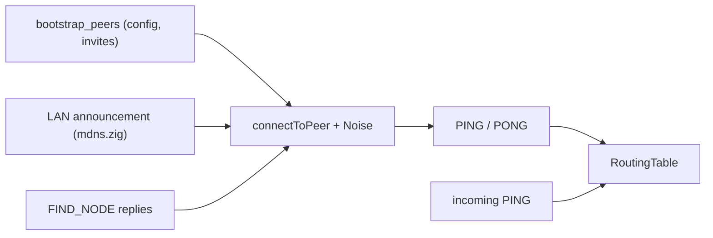

# Chapter 2: Discovery Layer Overview: The "Phonebook"

Without a central server, devices need a way to learn each other's addresses.
NomadFS uses a **Distributed Hash Table (DHT)** based on
[Kademlia](https://pdos.csail.mit.edu/~petar/papers/maymounkov-kademlia-lncs.pdf),
in `src/net/discovery/`. The same module also carries every other
request a device makes of a peer (blocks, share listings, the swarm folder
manifest, revocations, key rotation). `discovery.Node` is the RPC server and
client for the whole system.

> Overview with diagrams:
> [Learn: TCP, finding and reaching devices](https://nomadfs.foreachdeveloper.com/learn/tcp/#kademlia).

## 1. The Core Idea: XOR Distance

Every node has a 256-bit **node ID**: the BLAKE2s-256 hash of its X25519
transport public key (`NodeID.fromPublicKey`, `src/net/id.zig`). IDs aren't
random; a node keeps its ID as long as it keeps `node.key`. Kademlia measures
the distance between two IDs as their XOR:

$$distance(A, B) = A \oplus B$$

See [Chapter 2.1](./id.md).

## 2. The Routing Table: k-buckets

Each node keeps a `RoutingTable` of 256 buckets. Bucket *i* holds peers
whose ID shares exactly *i* leading bits with our own, up to K = 20 per
bucket, plus a replacement cache. A node knows many peers near its own ID and
a few far away. See [Chapter 2.2](./kbucket.md).

A peer enters the table only after it has answered over an authenticated
connection (a `PING` whose ID matches the handshake, or a reply during a
lookup), with the address that connection used. Peers merely *named* in
someone's reply ("hearsay") are not added, nor are third-party addresses for a
peer that did reply.

## 3. Where Peers Come From

*   **Bootstrap** (`Node.bootstrap` in `src/root.zig`): connects to each
    `bootstrap_peers` entry (up to 5 attempts, 1 s apart), sends `PING` and
    `DIAL_BACK` ([Chapter 1.6](../transport/nat.md)).
*   **LAN** (`discovery.Node.onDiscovery`): an announced, unknown node ID is
    dialed and pinged ([Chapter 1.5](../transport/mdns.md)).
*   **Incoming `PING`** (`handlePing`): the sender is added under the IP of
    the socket and the port given in the `PING`.

## 4. RPCs

The protocol has **21 message types** (`rpc.MessageType`), one request and
one reply per Yamux stream. Besides the four classic Kademlia RPCs (`PING`,
`FIND_NODE`, `FIND_VALUE`, `STORE`), they carry blocks, share listings, the
swarm manifest, provider records, revocations and key rotation. See
[Chapter 2.4](./rpc.md).

## 5. Iterative Lookup

To find a node, `Node.lookup(target)` asks the closest known peers for peers
closer still, with up to **α = 3** queries in flight, until nobody closer
turns up. See [Chapter 2.3](./lookup.md). In practice NomadFS looks up a
device's node ID when it isn't in the routing table
(`BlockManager.findPeer`, `src/cluster/block_manager.zig`).

## 6. Maintenance

After bootstrap, `runBootstrap` (`src/root.zig`):

| Task | When |
| :--- | :--- |
| Self-lookup (`lookup(own node_id)`) | once, after the bootstrap peers |
| `refreshBuckets()` | every 60 s; looks up a random ID in each bucket not updated for 1 hour |
| `sweepRevocations(4)` | every 60 s; pushes revocations to the 4 known peers closest to us |
| Bucket full | the least recently seen peer is pinged (`pingLruAndEvict`) and removed if it doesn't answer; a replacement is promoted |
| Failed query | the peer is removed (`markDisconnected`) |

There is no periodic ping of every peer.

## 7. How the Rest of NomadFS Uses the DHT

*   **Reaching a device**: shares and the swarm folder name the device that
    holds a file by node ID. `BlockManager.connectTo(peer_id)` finds it in
    the routing table, or with a lookup, and dials its addresses
    ([Chapter 1.4](../transport/management.md#4-address-priority-lan-vs-wan)).
*   **Listing peers**: `fs.remote.knownPeers` returns every peer in the
    table. The swarm folder syncs with all of them every 10 s
    ([Swarm folder](../../fs/swarm.md)).
*   **Provider records** (`ADD_PROVIDER` / `GET_PROVIDERS`, `providers.zig`,
    up to 20 per key, 24 h TTL) and **`STORE`/`FIND_VALUE`** are used by the
    `BlockManager` put/get path ([Cluster overview](../../cluster/overview.md)),
    not by shares or the swarm folder.

---

**Next Chapters:**
*   [Chapter 2.1: NodeIDs and XOR Math](./id.md)
*   [Chapter 2.2: K-Bucket Management](./kbucket.md)
*   [Chapter 2.3: Iterative Search](./lookup.md)
*   [Chapter 2.4: DHT RPC and Serialization](./rpc.md)
