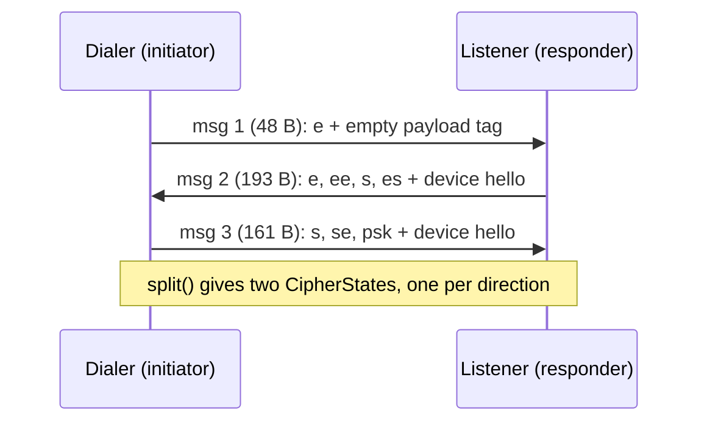

# Chapter 1.1: The Noise Protocol (Session Encryption)

Every TCP connection in NomadFS is encrypted with Noise, implemented
from scratch in `src/net/transport/noise.zig` on top of Zig's `std.crypto`.

## 1. The Protocol: `Noise_XXpsk3_25519_ChaChaPoly_BLAKE2s`

This string is the protocol name. `SymmetricState.init` hashes it into the
initial chaining key and handshake hash. NomadFS then mixes the prologue
`nomadfs-noise-v2` into the hash. v2 is the only supported handshake; the
previous 32-byte message 1 is rejected. All devices must be updated together.
Each `e` token is followed by both `MixHash(e)` and `MixKey(e)`, as required
by the Noise PSK modifier. The implementation is checked against the
Cacophony XXpsk3 vector, including its transport keys.

*   **XX**: both sides transmit their static public key during the handshake,
    encrypted. Neither needs to know the other's key in advance.
*   **psk3**: the Swarm Key is mixed into the key material at step 3, after
    both static keys are exchanged. A peer without the Swarm Key cannot
    complete the handshake.
*   **25519**: X25519 Diffie-Hellman (`std.crypto.dh.X25519`).
*   **ChaChaPoly**: ChaCha20-Poly1305 AEAD (`std.crypto.aead.chacha_poly`).
*   **BLAKE2s**: BLAKE2s-256 for the handshake hash, and HMAC-BLAKE2s HKDF for
    key derivation.

## 2. Key Concepts and Types

| Type | Role |
| :--- | :--- |
| `KeyPair` | an X25519 key pair. The node's *static* (transport) key lives in `node.key`, exactly 64 bytes (`public_key (32) ++ private_key (32)`), with mode `0600`. Key loading validates that the private key derives the public key (`recoverPublicKey`). Secret keys and key buffers are zeroed with `std.crypto.secureZero` on generation, load, save, and `NoiseStream.deinit`. `saveToFile` never overwrites an existing file. |
| `CipherState` | key `k` plus a 64-bit nonce counter `n`; `encryptWithAd` / `decryptWithAd`. The nonce is 4 zero bytes followed by `n` little-endian. |
| `SymmetricState` | chaining key `ck`, handshake hash `h`, and a `CipherState`. `mixKey`, `mixHash`, `mixKeyAndHash` (for the PSK), `encryptAndHash`, `decryptAndHash` and `split`. |
| `HandshakeState` | local static `s`, ephemeral `e`, remote `rs`/`re`, the PSK, the role, and the `device_auth.Authenticator`. |
| `NoiseStream` | the finished connection: send and receive `CipherState`s, `remote_static`, `remote_device_id`, final `handshake_hash`, and a read buffer. |

*   **Static key (`s`)**: the long-lived transport key. The DHT node ID is
    BLAKE2s-256 of its public half (`NodeID.fromPublicKey`).
*   **Ephemeral key (`e`)**: generated per handshake, which gives forward
    secrecy.
*   **Deadlines and timeouts**: handshake steps are bounded by a 10-second
    deadline (`handshake_timeout_ms = 10_000`); socket reads and writes honor
    deadlines, aborting if the peer stalls.

## 3. The Handshake Messages

Every message begins with a 2-byte big-endian length prefix. A message not
exactly the expected size (`error.HandshakeFailed`).



### Message 1: `-> e` (`writeMessage1` / `readMessage1`)
The initiator generates `e` and sends its 32-byte public key in the clear.
`mixHash(e.pub)` binds it to the transcript, and `mixKey(e.pub)` initializes
the cipher. Encrypting an empty payload adds a 16-byte tag, making message 1
48 bytes. This tag is checked by the responder; it does not authenticate
swarm membership because the ephemeral public key is public.

### Message 2: `<- e, ee, s, es` (`writeMessage2` / `readMessage2`)
1.  **`e`**: the responder's ephemeral public key (32 B), mixed into `h` and the chaining key.
2.  **`ee`**: `mixKey(DH(e_I, e_R))`. This replaces the key derived from `e`.
3.  **`s`**: the responder's static key, encrypted (32 + 16-byte tag = 48 B).
4.  **`es`**: `mixKey(DH(e_I, s_R))`.
5.  **Payload**: the responder's encrypted **device hello** (97 + 16 B).

### Message 3: `-> s, se, psk` (`writeMessage3` / `readMessage3`)
1.  **`s`**: the initiator's static key, encrypted (32 + 16 B).
2.  **`se`**: `mixKey(DH(s_I, e_R))`.
3.  **`psk`**: `mixKeyAndHash(swarm_key)`. This is where the swarm key enters.
4.  **Payload**: the initiator's encrypted **device hello** (97 + 16 B).

**Verification.** A responder with a different swarm key derives a different
key after `psk`, so decrypting the message 3 payload fails its Poly1305 tag
check. The error propagates from message 3 payload verification, and the
connection is closed.

**What leaks before the PSK check.** The responder's static key and device
hello in message 2 are encrypted only with keys from `ee` and `es`, before
the PSK is mixed in. A dialer that does not know the swarm key cannot finish
the handshake, but it *can* read message 2 and learn the identity of the
device it reached. The initiator's static key in message 3 is likewise
decrypted before the PSK is mixed in, but its device hello comes after.

## 4. Device Identity: the Device Hello (`src/device/auth.zig`)

The X25519 key is a *transport* key. A device's lasting identity is an
Ed25519 key (`device.key`, see `src/device/identity.zig`). Messages 2 and 3
carry a 97-byte hello that ties the two together:

```
hello = version (1, = 1) ‖ Ed25519 public key (32) ‖ signature (64)
signature = Ed25519.sign("nomadfs-device-auth-v1" ‖ h)
```

`h` is the handshake hash at the moment the hello is encrypted. In message 3
that hash already includes the PSK. The receiver captures `h` before
decrypting the payload and calls `Authenticator.verifyHello(hello, h, rs)`:

1. checks the version byte and length (`error.InvalidDeviceHello`);
2. verifies the signature over the same domain string and `h`. A hello from
   another session fails here, because `h` covers both ephemeral keys;
3. computes the device ID as BLAKE2s-256 of the Ed25519 public key;
4. if the trust store has an entry for that device, requires its pinned
   transport key to equal the handshake's static key `rs`
   (`error.TransportKeyMismatch`). An entry with no recorded transport key
   (all zeros) is not checked;
5. if `require_trusted` is set (config `require_trusted_devices = true`),
   requires the device to be trusted (`error.UntrustedDevice`).

`NoiseStream.handshake` accepts a null authenticator (tests and embedded
use). In that case it generates a throwaway Ed25519 identity, so the hello
exchange always happens.

The trust store, pairing tickets and revocation are covered in
[Device Identity & Pairing](../../security/pairing.md). Invites,
which run this same handshake with a token-derived PSK, are covered in
[Invites](../../security/invites.md).

## 5. After the Handshake: Transport Frames

`split()` derives two `CipherState`s. The initiator sends with the first and
receives with the second; the responder does the opposite. Each encrypted
frame on the socket looks like this:

```
[u16 BE length][ciphertext ‖ 16-byte Poly1305 tag]
```

*   `NoiseStream.write` splits data into chunks of at most **65,519 bytes of
    plaintext** (`max_payload = 65535 - 16`). Each chunk becomes one frame
    of at most 65,535 bytes, excluding the two-byte length prefix.
*   `NoiseStream.read` reads one frame (it refuses frames shorter than the
    tag or longer than its 65,535 + 16-byte buffer), decrypts it with an
    empty associated data, and buffers whatever the caller didn't take.
*   The nonce is the 64-bit frame counter. The reserved maximum counter is
    rejected with `error.NonceExhausted`.
*   On `NoiseStream.deinit`, cipher keys and read/write buffers are zeroed with
    `std.crypto.secureZero`.

## 6. Why Noise vs. TLS?

| Feature | TLS 1.3 | Noise (XXpsk3) in NomadFS |
| :--- | :--- | :--- |
| **Identity** | X.509 certificates, a CA | raw public keys; an Ed25519 device key signs the transcript |
| **Membership** | not part of TLS | the swarm key, as a PSK |
| **Complexity** | ASN.1, X.509, many cipher suites | one fixed suite, a few hundred lines of Zig |

The swarm key never crosses the network. It can be replaced on every
trusted device with a signed `ROTATE_KEY` message
(`src/device/rotation.zig`, see the [Security Model](../../security/model.md)).

---

**Next Chapters:**
*   [Chapter 1.2: Multiplexing with Yamux](./yamux.md)
*   [Chapter 1.3: Testing Network Logic](./testing.md)
