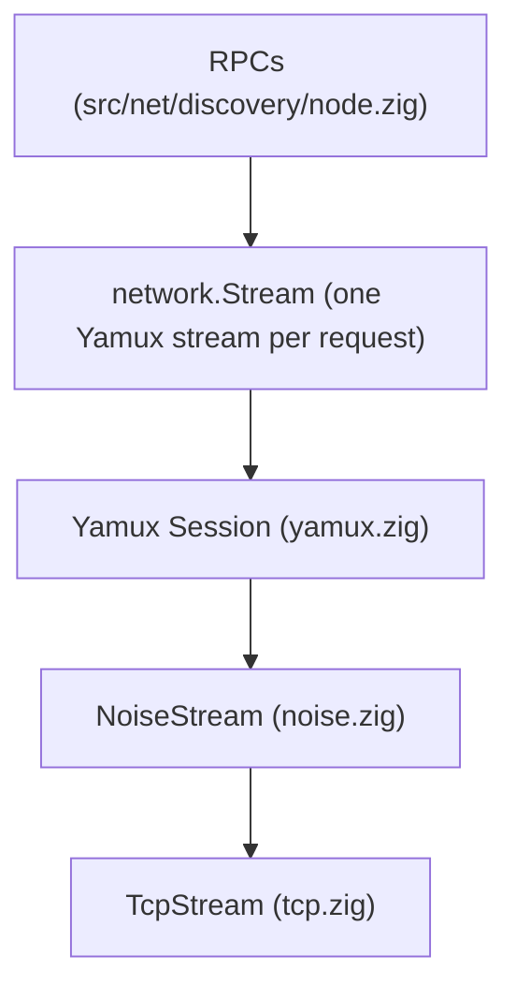

# Chapter 1: Transport Layer Overview: The "Pipe"

The transport layer turns a plain TCP socket into an encrypted, authenticated
connection that carries many independent streams. We call that connection the
**"Pipe"**. Everything above it (DHT requests, block transfers, share
listings, the swarm folder manifest) is a request/response exchange on one
stream of a pipe.

> For a short, diagram-led introduction see the site's Learn pages:
> [TCP: finding and reaching devices](https://nomadfs.foreachdeveloper.com/learn/tcp/),
> [Noise XXpsk3](https://nomadfs.foreachdeveloper.com/learn/noise/) and
> [Yamux](https://nomadfs.foreachdeveloper.com/learn/yamux/). This chapter is
> the code-level companion.

## 1. The Layers



1. **Transport (TCP)**: the operating system's byte stream (`TcpStream` in
   `src/net/transport/tcp.zig`). TCP is the only transport: the config parser
   rejects `transport = "quic"`, and `ConnectionManager` returns
   `error.QuicNotImplemented` for it.
2. **Security (Noise)**: `NoiseStream` runs the `Noise_XXpsk3_25519_ChaChaPoly_BLAKE2s`
   handshake and then encrypts every frame. The handshake also carries a
   signed Ed25519 *device hello* that binds the device identity to the
   session. See [Chapter 1.1](./noise.md).
3. **Multiplexing (Yamux)**: a `yamux.Session` splits the encrypted stream
   into numbered streams with per-stream flow control. See
   [Chapter 1.2](./yamux.md).
4. **Interface**: `network.Stream` and `network.Connection` in
   `src/net/transport/mod.zig` are vtable interfaces, so callers never see the
   concrete types. `Stream` has `read`, `write`, `close` and an optional
   `setTimeout`.

### Addressing and IPv6 Support (`src/net/compat.zig`)

The network abstraction `Address` handles IPv4 and IPv6 transparently:

*   **Scope and interface tracking**: IPv6 addresses preserve scope IDs (interface
    indices) and flow labels. Scope IDs are retained when dialing (essential
    for link-local `fe80::/10` connections) and compared when testing equality.
*   **Private address classification**: `isPrivate()` identifies IPv4 RFC 1918
    subnets as well as IPv6 Unique Local Addresses (ULA `fc00::/7`, such as `fc00::`
    and `fd00::`) and link-local ranges.
*   **POSIX conversion**: `Address.toPosix()` builds a `PosixAddress` union
    that emits properly sized and formatted `sockaddr_in` and `sockaddr_in6`
    structures, guaranteeing accurate `socklen_t` bounds during socket system calls.

## 2. Establishing a Connection (`tcp.zig`)

Both directions end in the same function, `establish()`:

```
dialer:   tcp.connect()  ── tcpConnectToAddressTimeout ──┐
listener: acceptLoop() → handleIncomingConnection()  ────┤
                                                         ▼
          establish(): setTimeout(handshake_timeout_ms)
                       NoiseStream.handshake(...)
                       setTimeout(0)          // idle connections are fine
                       YamuxSession.init(noise, is_server = !initiator)
                       spawn YamuxSession.run (the frame reader thread)
```

* The Noise handshake (and, for the dialer, the TCP connect) must finish
  within `default_handshake_timeout_ms = 10_000`. A peer that connects and
  stays silent cannot pin a handshake thread.
* Each accepted socket gets its own handshake thread, so one slow peer does
  not block the accept loop.
* After the handshake the socket has no read timeout: an established
  connection may sit idle. Individual streams get their own deadlines
  (`Stream.setTimeout`); the DHT uses `rpc_timeout_ms = 10_000` per request.
* A connection (`TcpConnectionImpl`) is **reference counted**. The last
  `deinit()` joins the Yamux reader thread and frees the session, the Noise
  buffers and the socket. See [Chapter 1.4](./management.md).

## 3. Identities on a Connection

A finished handshake leaves two identities on the connection:

| Accessor | Value | Derived from |
| :--- | :--- | :--- |\n| `getRemoteNodeID()` | DHT node ID | BLAKE2s-256 of the peer's X25519 static key (`NodeID.fromPublicKey`, `src/net/id.zig`) |
| `getRemoteDeviceID()` | device ID | BLAKE2s-256 of the peer's Ed25519 identity key, from the verified device hello (`src/device/auth.zig`) |

The DHT routing table is keyed by node ID. Pairing, the trust store,
revocation and key rotation use the device ID. See
[Chapter 2.1](../discovery/id.md).

## 4. The Supporting Pieces

* **[ConnectionManager](./management.md)** (`manager.zig`): pools
  connections, dials addresses in priority order, runs the reaper thread, and
  hands every new connection to the connection handler (in a running node,
  `discovery.Node.serve`).
* **[LAN announcements](./mdns.md)** (`mdns.zig`): a small UDP multicast
  beacon that lets devices on the same network find each other.
* **[UPnP and DIAL_BACK](./nat.md)** (`nat.zig`): asks the router to forward
  the listening port, and asks a bootstrap peer to dial back.
* **[Relaying](./relay.md)** (`relay.zig`): reaches a device none of whose
  addresses answers through another device both can reach, end-to-end
  encrypted.
* **[Testing](./testing.md)**: in-memory pipes and multi-node tests on
  loopback.

## 5. Not implemented yet

[ROADMAP.md](../../../ROADMAP.md) plans Yamux `PING` keep-alives to hold
NAT mappings open. The Yamux session answers pings, but nothing sends them.

---

**Next Chapters:**
*   [Chapter 1.1: Security & The Noise Handshake](./noise.md)
*   [Chapter 1.2: Multiplexing with Yamux](./yamux.md)
*   [Chapter 1.3: Testing Network Logic](./testing.md)
