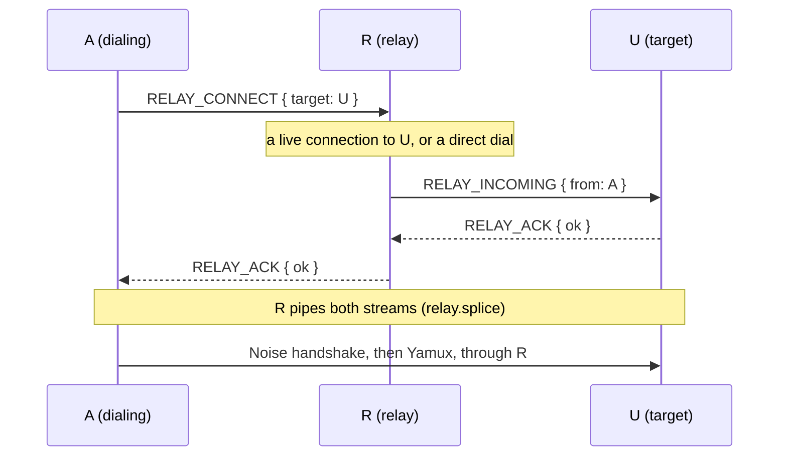

# Chapter 1.7: Relaying Through Another Device

Two of your devices can be unable to reach each other at all: a home server
that is only on the home network, and a phone on mobile data that only has
Tailscale. A third device that both can reach (the desktop, on both) can
carry the connection. NomadFS does this without anything to configure: when
no address of a device answers, the dialing device asks the devices it is
connected to whether they can reach it.

## 1. What travels where (`src/net/transport/relay.zig`)

A relayed connection is the same stack as a direct one, run over a stream
of the connection to the relay instead of over a TCP socket:

```
A ── TCP / Noise / Yamux ── R ── TCP / Noise / Yamux ── U
     └ stream ─────────────────┘└ stream ────────────────┘   piped by R
       └ Noise XXpsk3 + Yamux, end to end between A and U ┘
```

- A and U run the full Noise `XXpsk3` handshake with the swarm key and the
  device hello over the piped stream, then a Yamux session. R only ever sees
  ciphertext, and A and U authenticate each other exactly as they would
  directly.
- `relay.establish(allocator, base, via, ...)` builds the connection. It
  holds a reference to `via`, the connection to the relay, so that one stays
  up (and isn't reaped as idle) while the relayed one is in use.
- `getPeerAddress()` returns `0.0.0.0:0`: the socket belongs to the relay
  and says nothing about the device. `PING`/`PONG` and `DIAL_BACK` skip an
  unspecified address, so a relayed connection never plants a wrong address
  in the routing table; the device's own announced addresses are still
  recorded.
- Closing it calls `shutdown()` on the stream through the relay (new in
  `network.Stream`, implemented by Yamux): blocked reads end and writes fail,
  but the stream stays allocated until the Yamux reader has been joined. The
  stream is then closed exactly once by the Noise stream's `deinit`.

## 2. Setting it up (`src/net/discovery/node.zig`, RELAY_*)



1. **`ConnectionManager.connectToPeerMulti`** tries every address first
   (`connectDirect`). If none answers and the device's node ID is known, it
   calls `relay_dialer`, which `Node.enableRelay` points at
   `Node.dialThroughRelay`.
2. **`dialThroughRelay(target)`** walks `manager.liveConnections()` and sends
   `RELAY_CONNECT` to each until one answers `RELAY_ACK { ok = true }`, then
   runs `relay.establish` as the Noise initiator and registers the
   connection with the manager like any other. Later dials find it by node
   ID. If no relay reaches the device (it is usually just off), dials to it
   don't ask relays again for `relay_retry_ms` = **60 s**.
3. **`handleRelayConnect`** (on R) reaches the target through a live
   connection or a direct dial to the addresses in its routing table
   (`connectDirect`), never through another relay: relays don't chain, and
   a relayed connection is never used as one. It sends `RELAY_INCOMING`,
   waits for the target's `RELAY_ACK`, answers A, then `relay.splice` copies
   bytes both ways until either side ends, and closes both streams. At most
   `max_relays` = **32** streams are piped at once.
4. **`handleRelayIncoming`** (on U) answers `RELAY_ACK`, takes the stream
   over, runs `relay.establish` as the Noise responder, checks that the
   authenticated peer is the `from` it was told, and registers the
   connection.

Request handlers normally close their stream when they return;
`handleRequest` returns `true` when a relay message took the stream over.

Only members of the swarm can ask for a relay (the connection to R is
authenticated with the swarm key), and R only connects to devices it already
knows by node ID. A device on 0.3.3 or older doesn't know these messages and
closes the stream, which the dialing side treats as "no".

## 3. Limits

- The relay carries all the traffic: a video streamed from the home server
  to a phone through the desktop crosses the desktop's network twice.
- A device nobody can dial stays reachable only while it keeps a connection
  open to a relay. Its own periodic lookups (every 30 s) and redials keep
  one open in practice; idle connections are reaped after 5 minutes.
- There is no hole punching: two devices behind NAT always go through the
  relay, even when a direct path could be opened.
