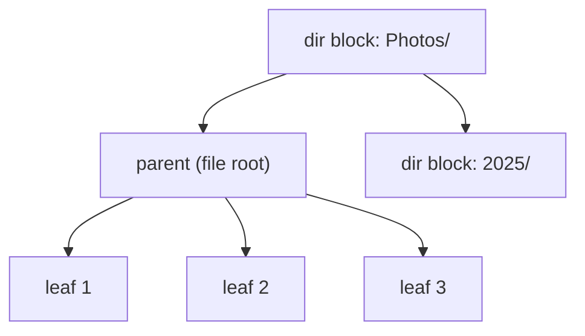

# Chapter 3: The Storage Stack (`src/storage/`)

NomadFS doesn't store files as single blobs. It uses **content-addressed storage**: every piece of data is a *block* named by the SHA-256 hash of its bytes, and files and folders are trees of such blocks (**Merkle DAGs**).

> Concept pages on the website, with diagrams:
> [SHA-256 and content addressing](https://nomadfs.foreachdeveloper.com/learn/sha-256/) ·
> [FastCDC](https://nomadfs.foreachdeveloper.com/learn/fastcdc/) ·
> [Merkle DAG](https://nomadfs.foreachdeveloper.com/learn/merkle-dag/).
> This chapter is the code-level companion.

## 1. Content Addressing & CIDs

A traditional file system finds data by path (`/home/user/photo.jpg`). NomadFS finds a block by its **Content Identifier (CID)**:

*   A CID is the **SHA-256** digest (32 bytes) of the block's *encoded* bytes: a one-byte tag followed by the body (see [Chapter 3.2](./dag.md)).
*   If the bytes change, the CID changes. Identical bytes always get the same CID.
*   **Deduplication**: the block store keeps one copy per CID. Writing a block that already exists does nothing.
*   **Verification**: whoever holds a CID can check any bytes claimed to match it. NomadFS re-hashes every block it reads from disk and every block it receives from a peer.

## 2. Chunking & Blocks

Files are split by **content-defined chunking** (FastCDC: 64 KiB minimum, 256 KiB normal size, 1 MiB maximum, `src/storage/chunker.zig`). Each chunk becomes a *leaf* block. See [Chapter 3.1](./block.md).

## 3. The Merkle DAG

Leaves are linked by *parent* blocks (up to 174 links each), and parents by more parents, until one root remains. Folders are *dir* blocks whose entries point at file roots and at other dir blocks.

Because a parent contains its children's CIDs, the root CID commits to every byte below it. See [Chapter 3.2](./dag.md).

## 4. The Local Storage Engine

`src/storage/engine.zig` (`StorageEngine`) persists blocks as flat files named by their hex CID under `storage_path`. It verifies hashes on `put` and on `get`, writes through a temp file and a rename, and can ask an external source (the shared-folder *filestore*) for blocks it has no file for. There is no index, no garbage collection, no delete and **no encryption at rest**: confidentiality is provided only by the encrypted transport. See [Chapter 3.3](./engine.md).

## 5. Module Map

| File | Contents |
| :--- | :--- |
| `src/storage/block.zig` | `Block { cid, data }`, `Block.new` (hashes the bytes) |
| `src/storage/chunker.zig` | FastCDC `cut()` and the streaming `Chunker` |
| `src/storage/dag/codec.zig` | Block encoding: leaf, parent, dir; `decode` validates peer input |
| `src/storage/dag/builder.zig` | `DagBuilder`: chunk a stream and link the leaves |
| `src/storage/dag/walk.zig` | `readFile`, `isComplete`, `collectReachable` over a DAG |
| `src/storage/dag/node.zig` | `MerkleNode` / `DagLink`, the builder's in-memory form |
| `src/storage/dag/diff.zig` | `DiffService`: compiled and tested, not used by the node |
| `src/storage/engine.zig` | `StorageEngine`: the on-disk block store |

Reading a range of a file, as shares, the swarm folder and the FUSE mount do, lives in `src/fs/tree.zig` and is covered in [Shared Folders](../fs/shares.md).

---

**Next Chapters:**
*   [Chapter 3.1: Chunking & Blocks](./block.md)
*   [Chapter 3.2: Building the Merkle DAG](./dag.md)
*   [Chapter 3.3: The Disk Engine](./engine.md)
